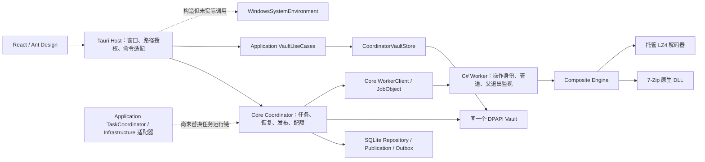

# OpenUnpack 代码与架构审计报告

审计日期：2026-10-13（Asia/Shanghai）。结论：**需要整改；当前证据不足以作出全面安全或正式发行验收通过的判断。**

项目已有真实 Windows Worker 集成、发布事务、恢复日志、密码库加密和不少有效回归保护。主要风险集中在不可信归档的资源与完整性边界、恢复后的结果质量、即时密码与归档浏览流程，以及磁盘调度和新旧架构迁移的一致性。格式与严格静态质量门禁未通过。测试通过不能覆盖本报告已复现的缺口。

登记 **31 项编号发现：2 High、24 Medium、5 Low**，另保留 H01/H02 两项安全加固及其他维护观察。发现包含已复现缺陷和明确标注 E1 的潜在/迁移风险，不能把总数理解为已利用的漏洞数量。

| 领域 | 编号 | High / Medium / Low | 优先事项 |
| --- | --- | --- | --- |
| 安全 | S01–S10 | 2 / 8 / 0 | 探测预算、来源标记、LZ4完整性、审计门禁 |
| 架构/恢复/调度 | A01–A07 | 0 / 5 / 2 | 交付质量、提交后状态、磁盘身份、缓存等待 |
| UI/用户流程 | UH01–UH06 | 0 / 5 / 1 | 临时密码、浏览重复请求、异步草稿和状态成本 |
| Worker/格式/性能 | W01、W02、W04–W07 | 0 / 6 / 0 | LZ4排除、结果分类、重复解码、大清单分配 |
| 代码维护 | Q01、Q02 | 0 / 0 / 2 | Rust门禁与底层镜像一致性 |

本轮执行审计、独立小样本验证和报告整理，**没有修改业务代码、删除用户数据、切换架构或制作新发行版**。原有未提交修改保持原状。新增材料包括方案、执行台账、独立探针及两个专用于暴露缺陷的 UI 审计用例。

## 1. 审计方案、范围与判断规则

先制定并保存了 [系统化审计方案](<C:/Users/im/Documents/ChatGPT/批量解压缩/docs/plans/2026-10-13-project-audit.html>)，随后按 P0–P6 执行；详细记录见 [执行台账](<C:/Users/im/Documents/ChatGPT/批量解压缩/_workspace/project-audit-2026-10-13/execution-ledger.md>)。最终结论以当前工作区为对象，不把旧报告或设计文档当作当前实现证据。

基准分支 `codex/open-unpack`，commit `cf6e34411c809d092c48ed2f4bdd4ab6160222c1`。仓库存在大量 dirty/untracked 内容，因此 commit 不是完整重现材料。已冻结 202 个源码、配置、依赖锁文件及脚本的路径、行数和 SHA256：[源文件清单](<C:/Users/im/Documents/ChatGPT/批量解压缩/_workspace/project-audit-2026-10-13/source-manifest.json>)。结束时重新计算 202 项摘要，0 项漂移；新增审计用例单独列明。这是覆盖清单，不表示每行均有同等深度的人工审查。

| 阶段 | 范围与评估维度 | 执行方法与产出 |
| --- | --- | --- |
| P0 基线 | 分支、现有修改、实际运行入口、旧问题状态 | 保存基线与摘要，排除历史结论污染 |
| P1 架构与契约 | React/Tauri、Rust 各层、C# Worker/Engine；依赖方向、写入所有权、DTO、能力接入 | 追踪真实调用链、比对新旧层、结构检查和跨语言往返 |
| P2 质量与异常 | 格式、静态检查、异步生命周期、错误分类、取消、恢复、发布、清理 | 检查错误出口与状态转换，运行质量门禁和恢复探针 |
| P3 性能与交互 | 并发、HDD/SSD 仲裁、缓存配额、重复解码、快照、树渲染、导入 | 复杂度与 I/O 分析、有限规模计时、定向 UI 用例 |
| P4 安全与依赖 | 注入、身份和授权、秘密、文件路径、原生隔离、配额、完整性、供应链 | 复核此前同会话安全证据与源码摘要，检查依赖扫描边界 |
| P5 验证 | 前端、Rust 工作区、实际 C# DTO、真实 Worker v2、无害原生样本 | 记录命令退出与结果，区分默认测试和新增失败用例 |
| P6 汇总 | 风险等级、影响、修复依赖、负责人、验收与回退 | 本报告、整改矩阵和尚未完成的验收边界 |

覆盖 UI、Host、Core、Domain、Application、Infrastructure、Protocol、Worker、Engine、相关测试、CI、打包/安装和依赖锁文件。`.pi/agents` 等只作为审计编排说明，不作为产品功能计数；辅助 Gemini 插件不属于本次应用安全认证范围。未读取个人密码库或个人归档。

**威胁模型：** 不可信归档/文件名/分卷、导入与备份文本、选择器返回路径、并发变化的文件系统和 WebView 命令参数进入可信桌面进程。重点保护密码、源文件、既有输出、任务数据库和机器资源。应用采用当前 Windows 用户和可信主窗口模型，没有远程账户或多租户登录；缺少服务器式登录不构成漏洞。拥有同用户目录写权限的并发主体，与只能提供归档的攻击者分开评价。

**严重度：** High 表示主要安全边界或后续打开文件的保护明显减弱；Medium 表示可达的功能、完整性、可用性或性能缺陷，但受操作/环境前提限制；Low 表示维护、可观测性或尚未接入生产的迁移风险。P1/P2/P3 是整改顺序，不等同严重度。可信度 High 表示控制流或小样本证据明确，不表示所有影响均已实际发生。

**证据等级：** E1 为源码与可达链；E2 为构建、组件/隔离测试；E3 为真实 Windows Worker、引擎或文件系统；E4 为完整桌面、安装和真实硬件验收。本次不把 E1/E2/E3 替代 E4。不运行恶意代码、资源耗尽攻击、真实目录破坏或安装卸载。

## 2. 当前架构与能力状态

入口与关键持有关系见 [Host:1497](<C:/Users/im/Documents/ChatGPT/批量解压缩/apps/desktop-host/src/lib.rs:1497>)、[Core:304](<C:/Users/im/Documents/ChatGPT/批量解压缩/crates/core/src/coordinator.rs:304>)。当前没有 Rust crate 依赖环：Domain 独立，Application 依赖 Domain/Protocol，Infrastructure 依赖 Application/Domain/Protocol，Core 依赖 Protocol。Infrastructure 已解除对 Core 的 crate 依赖，部分底层实现通过源码副本保留，不能沿用旧的“直接委托 Core”描述。

| 能力 | 当前状态 | 审计判断 |
| --- | --- | --- |
| 扫描、内包重试、结果发布、恢复、删除 | 已接入 Core 生产链 | 有真实 Worker/文件系统回归；恢复质量与提交后错误仍有缺口 |
| 多归档并发 | 已实现 1–4 个任务的 JoinSet 调度 | 单个 Worker 一次操作；并发不证明 HDD 仲裁和缓存公平性正确 |
| 原生引擎内部线程、后台异步 | 已有配置/执行路径 | 与多归档并发、并行密码尝试分别评价；不宣称所有格式均支持内部并行 |
| HDD/SSD 路由、缓存账本 | 部分可用 | 账本已防止超额预留；路径识别和阶段资源登记存在缺口 |
| 密码库 Application UseCases | 已接入 | Host adapter 使用同一个 Core Vault，没有新增第二个生产密码库写者 |
| WindowsSystemEnvironment | 构造并存入状态，未被生产调用 | 本报告及安全报告已校正此前“已接入”的过宽表述 |
| Application TaskCoordinator / JobUseCases | 部分实现，未接入 Host 任务链 | 缺少 Core 对等的执行、恢复、发布与 outbox 闭环 |
| SqliteTaskStore 迁移 | 适配器实现并测试，未生产切换 | 有独占格式租约、WAL 完整备份和事务保护；不是桌面迁移验收 |
| Infrastructure Vault/WorkerSupervisor | 实现与测试存在，未接入 Host | 与 Core 底层实现近似重复，需防漂移 |
| 增量队列状态 | 尚未实现实体增量 | 当前为版本失效事件后再读取完整快照；虚拟表格只减少 DOM |

正常桌面有实例锁；Core 在持久化成功后才更新可见状态，数据库迁移另有格式租约。未发现“当前桌面必然存在多个并发写者”的证据。不能因为目标层尚未接入就直接删除：测试、迁移及后续兼容依赖仍存在。

## 3. 已确认的安全风险

下表保留同会话 [完整安全报告](<C:/Users/im/Documents/ChatGPT/批量解压缩/docs/security-audit-2026-10-13.md>) 的 S01–S10 编号，避免重复计数。8 个关键源码摘要重新核对未变化，原动态证据可复用；本轮没有重新进行资源攻击或剪贴板系统实验。每项完整位置、前提和原始证据见该报告，下表给出执行所需的修复与验收条件。

| ID / 等级 / 证据 | 风险与影响 | 具体修复与验收 |
| --- | --- | --- |
| S01 High / High / E3 | Probe 未遵守展开预算；心跳可持续刷新无响应计时，缺进程内存/CPU限制与独立总期限。4096 字节普通 ZIP 在 1 字节 Probe 配额下仍完成；未耗尽机器资源 | 在 Host→Worker→Engine 增加 ProbePolicy，限制枚举/解码/内存；JobObject 和独立总期限保护所有操作。小配额应 ResourceLimit，心跳不能续命，取消必须确认子进程退出 |
| S02 High / High / E3 | Internet ZIP 的 ZoneId=3 未传播到输出；用户之后打开程序或 Office 文件时保护可能减弱，不是自动执行漏洞 | 在缓存前读取受控来源标记，经内包/跨盘/发布传播；禁止归档任意 ADS。NTFS 上全链保留 zone，不支持 ADS 的目标有明确策略 |
| S03 Medium / High / E1 | 密码只写 CF_UNICODETEXT，30 秒清当前剪贴板不能撤回历史/云副本；依赖用户系统开关 | 同事务写 Windows 排除历史/同步格式，失败拒绝复制；保留 sequence 清理。用隔离合成密码验证 Win+V/同步，不接触用户当前秘密 |
| S04 Medium / High / E3 | 工具箱普通 C 盘字符串黑名单被 canonical `\\?\` 表示绕过，保护目录可能进入批处理；不会突破 ACL | 用统一路径组件和稳定身份比较，Known Folder/System Directory 获取实际目录。普通/verbatim/非 C 系统盘表示一致拒绝，近似名称正常允许 |
| S05 Medium / High / E3 | 执行使用新选项重算计划，没有绑定已展示预览；无害文本实际产生未预览的新名称 | 参数改变失效预览；后端一次性 token 绑定计划、源/目标及文件版本。过期/变更计划必须重新确认，不允许旧 token 产生新目标 |
| S06 Medium / High / E1 | 存在性检查到 rename/copy 间有竞态，rename 任意失败后 copy 可覆盖竞争目标；要求另一主体可写目录 | 使用句柄/原子不覆盖操作；仅明确跨卷错误进入受控 copy；源/目录身份重验。实际并发夹具验证不覆盖；本次未利用真实竞态 |
| S07 Medium / High / E3 | LZ4 不校验 header/block/content checksum及完整结束；截断无害帧被标成功，损坏数据可获得过宽验证声明 | 校验帧标志、所有 checksum/ContentSize/EndMark和消费边界；不支持依赖块/字典则创建输出前 Unsupported。参考工具生成有效/损坏变体，损坏绝不成功发布或自动清源 |
| S08 Medium / High / E3 | 防扩展点注入策略使用枚举 3，实际对应 StrictHandleCheck，且忽略失败返回 | 使用具名枚举 6、检查设置结果并回读。真实进程策略必须启用预期项；不是原生 DLL RCE 的证明 |
| S09 Medium / High / E1 | 安全脚本 catch 吞掉自身漏洞/扫描失败并可记录通过，英文关键词解析未核退出 | 按 scanner JSON/退出码判定，漏洞/失败 fail closed，缺工具显式 skipped，不能算成功。注入发现、网络失败、缺工具和非英文输出验证门禁 |
| S10 Medium / High / E1+小样本 | 工具箱遍历/计划和 Host ZIP 编码解析缺少统一预算；ZIP 目录尺寸边界小样本超出声明仍读记录，未确认完整原生攻击链 | 所有额外解析有条目/字节/深度/时间和取消预算；先编译规则、分页计划，ZIP读取限制在可信目录边界。超限明确失败，保留源，原生畸形样本需独立补证 |

LZ4 本轮还核实 Inspect 把 50 字节压缩文件报为 50 字节展开大小，实际展开 35 字节。`CompositeArchiveEngine` 的 LZ4 Inspect 分支也没有使用传入的元数据配额。应在 S10 整改中把“未知展开量”明确编码，不能将压缩长度伪装成已验证的展开量。依赖块/字典能力依据 [上游 LZ4 帧规范](https://raw.githubusercontent.com/lz4/lz4/dev/doc/lz4_Frame_format.md)；多帧是否支持需声明，不能把规范允许的实现选择本身称为漏洞。

**低风险加固：** H01：自包含 .NET Runtime 固定 10.0.9，NuGet 查询不覆盖它，需升级受支持安全补丁并重新打包/验收；没有确认本 Worker 可达 TLS/WPF 的公告攻击路径。H02：密码临时副本和部分模态框状态未及时清理，需保留原文、缩短生命周期、在关闭/换任务时清空状态，后端临时缓冲尽量 zeroize；托管/JS 内存不能承诺彻底擦除。

**没有确认的常见漏洞：** 数据库参数化、以参数列表启动 Worker/引擎、前端转义显示、可信 main 窗口/origin 检查、Host 文件授权、当前用户管道权限、操作/generation/candidate 身份核对、相对路径/设备名/ADS/重解析点拒绝均构成有效保护。未发现明确 SQL/命令注入、XSS、IPC 身份验证绕过、静态 Zip Slip 或任意链接写出。该结论不覆盖尚未进行的原生 fuzzing 与并发竞态利用，不等同不存在漏洞。

**依赖结果与边界：** 同会话 npm audit 检查 356 条依赖记录、cargo audit 检查 513 条，未报已知漏洞；NuGet 查询未报漏洞。Cargo 有 `proc-macro-error 1.0.4` 维护告警与 `glib 0.18.5` unsound 告警，两者在当前 Windows 目标依赖树中均无可达条目；不是当前 Windows 载荷的已确认漏洞。见 [RUSTSEC-2024-0370](https://rustsec.org/advisories/RUSTSEC-2024-0370.html)、[RUSTSEC-2024-0429](https://rustsec.org/advisories/RUSTSEC-2024-0429.html)。原生 DLL 当前为 7-Zip 26.04。版本扫描不是本地代码安全证明，S09 必须先修复，发行审计应重新扫描冻结产物并覆盖自包含 runtime。

## 4. 架构、恢复与调度发现

### A01：规范化路径使真实磁盘识别与 HDD 仲裁失效

**Medium / High / P1 / E3（路径识别），实际 HDD 竞争影响为 E1。** [paths:576](<C:/Users/im/Documents/ChatGPT/批量解压缩/crates/core/src/paths.rs:576>) 仅接受以盘符开头的字符串；生产 Scanner/Host 会返回 Windows verbatim 路径。[route:62](<C:/Users/im/Documents/ChatGPT/批量解压缩/crates/core/src/route.rs:62>) 探测失败后把完整文件名当成备用设备身份，Unknown 又不被当作 HDD。

只读实测同一 Windows 目录：普通形式为 Ssd、物理设备 Some(1)，canonical 形式为 Unknown/None；同一卷两个 canonical 文件路径得到不同 endpoint。实际 HDD 上可能漏掉同盘互斥和正确路由评分。本机实验没有使用真实 HDD，不宣称硬件性能验证。

**修复：** 共享 Path Prefix::Disk/VerbatimDisk/UNC 解析，按稳定卷/物理盘/共享身份回退，Unknown 保持显式保守策略。Infrastructure 重复 parser 同步处理。**验收：** 普通/canonical 别名一致；注入拓扑验证同 HDD 至多一个任务、独立盘可并发，再用真实设备核实。

### A02：恢复流程把 CRC 抢救结果提升为普通完成

**Medium / High / P1 / E3（cleanup 分支），verify 分支 E1。** [Coordinator:2570](<C:/Users/im/Documents/ChatGPT/批量解压缩/crates/core/src/coordinator.rs:2570>) 只按输出存在与失败节点决定 partial/completed；[2654](<C:/Users/im/Documents/ChatGPT/批量解压缩/crates/core/src/coordinator.rs:2654>) 只看 journal.partial，忽略 publication 文件的 is_corrupted，并把范围改为 targetReadback。

独立合成库设置 cleanupPending + salvagedWithCrcWarning+targetReadback，调用真实 recover(cleanup) 后状态变成 completed，输出保持存在，临时目录正确清理。清理成功不能证明原始数据完整；恢复 UI 会丢掉抢救警告。

**修复：** 统一交付质量分类，损坏优先于 partial/completed；发布、清理、回读、重启和删除完成路径复用该规则，必要时显式持久化质量。**验收：** 抢救 cleanupPending 清理后仍 salvaged；is_corrupted 的待发布记录完成真实回读后仍带警告；partial+corrupt 组合不升格。

### A03：提交后附带操作失败可把已交付结果标为失败或取消

**Medium / High / P1 / E3（真实 Coordinator + 隔离数据库故障）。** [Coordinator:2377](<C:/Users/im/Documents/ChatGPT/批量解压缩/crates/core/src/coordinator.rs:2377>) 已原子提交 publication/job/outbox，随后 [2429](<C:/Users/im/Documents/ChatGPT/批量解压缩/crates/core/src/coordinator.rs:2429>)、2438、2439 仍可返回存储/统计错误。[外层分类:1165](<C:/Users/im/Documents/ChatGPT/批量解压缩/crates/core/src/coordinator.rs:1165>) 仅优先检查“未解决发布”，已 committed 时可改成 failed/cancelled，与代码中“交付后取消不能变成 cancelled”的约束矛盾。

**影响：** 存储故障发生在正式交付之后时，用户可能误以为没有有效输出，再次重试；结果质量和后处理问题混在一起。**修复：** 将交付提交作为边界，提交后保留交付状态/质量，另报 cleanupPending 或后处理诊断；异常出口同时检查已提交交付。**验收：** 隔离数据库仅拒绝 completed→completed 更新，确保 running→completed 提交成功，再触发附带保存失败；检查输出、质量、取消时序和重启一致。

初始夹具普通路径在 planning 阶段遇原子文件写入失败；按现有集成测试使用 canonical 路径后，注入仅拒绝 completed→completed 保存的数据库 trigger，真实任务最终变成 failed，但 output_path 存在、safe.txt 已交付、publication 为 committed。这确认了提交后错误分类缺陷；未清理或删除源文件。取消和抢救组合尚需补验。

### A04：缓存预留过于保守，资源释放后等待任务不会自动再调度

**Medium / High / P2 / E1。** [Coordinator:1520](<C:/Users/im/Documents/ChatGPT/批量解压缩/crates/core/src/coordinator.rs:1520>) 为阶段预留最大允许展开量与配额的较小值；默认 100 GiB 展开上限与 20 GiB 缓存配额下，小包也可先占满可预留份额。另一任务进入 waitingResource；[1274](<C:/Users/im/Documents/ChatGPT/批量解压缩/crates/core/src/coordinator.rs:1274>) 仅选 queued，释放后没有自动唤醒。

这是现有安全账本的吞吐/策略限制，**不是旧的共享配额超额漏洞**。**修复：** 区分暂时资源竞争和单包越限；采用安全排队唤醒，或可信估算加受限增长预留，保持总额不超配额。**验收：** 两个合计可容纳的小包无需手动重试最终完成；不能并存的大包安全串行/等待；峰值缓存始终受限。既有“一个完成、一个等待”用例不证明最终公平性。

### A05：缓存任务未登记最终输出盘的阶段占用

**Medium / High / P2 / E1，依赖 A01。** [Coordinator:1259](<C:/Users/im/Documents/ChatGPT/批量解压缩/crates/core/src/coordinator.rs:1259>) 活跃任务使用 source + workspace 资源，缓存时 workspace 在 SSD；[2228](<C:/Users/im/Documents/ChatGPT/批量解压缩/crates/core/src/coordinator.rs:2228>) 后续写回/回读最终 HDD，资源表没有随阶段更新。另一输出到该 HDD 的任务可被同时调度。另一方面，已退休的源盘仍可能被全程占用。

**修复：** 按阶段登记实际 I/O 设备并在确认阶段退出后释放；先用保守地包含最终输出盘作为小改动也可。**验收：** source=A/cache=S/final=H 的集成拓扑在 copy/readback 时互斥 H，其他独立盘继续运行；不能只测独立 Scheduler 对象。

### A06：丢弃 JoinError，异常任务缺少持久化终态

**Low / High / P2 / E1，未找到普通输入可触发的 panic。** [Coordinator:1141](<C:/Users/im/Documents/ChatGPT/批量解压缩/crates/core/src/coordinator.rs:1141>) 和 1221–1228 忽略 join 结果；per-job 资源清理在 run_job.await 之后，unwind 会跳过。驱动本身 [1131](<C:/Users/im/Documents/ChatGPT/批量解压缩/crates/core/src/coordinator.rs:1131>) 被分离启动。

**影响：** 意外异常可能保留 running 状态、活跃设备或批次运行标志，用户不能准确判断任务是否结束。**修复：** 关联 Tokio task id/job id，显式处理 JoinError；增加任务/驱动所有权 guard 和 durable interrupted/stopping 状态，不能在 unwind 时伪称 Worker 已退出。**验收：** 注入 panic 后保留源/工作目录、明确终态、解除正确所有权且不阻塞其他任务。

### A07：目标分层尚不具备生产切换对等性，文档夸大完成状态

**Low / High / P2 / E1；切换前必须解决。** [Application Coordinator:38](<C:/Users/im/Documents/ChatGPT/批量解压缩/crates/application/src/use_cases/coordinator.rs:38>) 重启加载 Running/Stopping 原样保留，未具备 Core 的退出/中断核对；[TaskStore port:5](<C:/Users/im/Documents/ChatGPT/批量解压缩/crates/application/src/ports/task_store.rs:5>) 缺发布/outbox/恢复契约。JobUseCases.retry 选择 Queued，但 [Domain 状态机:93](<C:/Users/im/Documents/ChatGPT/批量解压缩/crates/domain/src/jobs/state_machine.rs:93>) 不允许 NeedsPassword/WaitingResource→Queued。这是未使用层的对等缺口，不是当前 Core 重试失效。

README 的“顺序队列/CSV尚未实现”、PLAN 的“新架构全面接入/UI无inspect/无密码派生”均与当前代码不一致。**修复：** 维护已实现/部分/计划及证据等级矩阵；先补启动核对、真实 Worker、冻结设置、节点恢复、发布事务/outbox和质量语义，再双链同夹具核对。**验收：** 同输入、故障、取消、重启、迁移回退在两条链取得对等结果；之后才切 Host，保留单写者和可恢复数据。

## 5. UI、用户流程与性能发现

### UH01：进度更新会重复读取归档，并重置浏览状态

**Medium / High / P1 / E2 + 原生可达链 E1。** [ArchiveBrowser:135](<C:/Users/im/Documents/ChatGPT/批量解压缩/apps/desktop-ui/src/components/ArchiveBrowser.tsx:135>) effect 依赖整个 job。App 全量快照更新会产生同任务新对象，触发 load，清空密码/搜索/展开状态；request sequence 只忽略旧结果，不取消旧 Worker。Host inspect 创建自己的 cancel token，不受队列 concurrency 自动约束。

新增定向组件用例：同 id/source 只更换 progress 的 job 对象，inspect 调用由 1 次变为 2 次，所需行为断言失败。**影响：** 活跃任务下重复 CPU/I/O/内存和 scratch 开销，浏览输入丢失；完整桌面持续并发次数尚未测量。

**修复：** effect 使用稳定的源身份/版本；同会话最多一个 inspect；关闭/换源/supersede 取消旧操作，确认 Worker 退出后清理。**验收：** progress-only 不 invoke/重置；换源仍拒绝旧结果；真实 Host 持续进度与关闭测试确认操作数量和退出。

### UH02：即时密码“不保存”时没有用于重试，保存时会裁剪原文

**Medium / High / P1 / E2（空格裁剪）、E1（临时密码缺失）。** [Queue:241](<C:/Users/im/Documents/ChatGPT/批量解压缩/apps/desktop-ui/src/components/QueuePage.tsx:241>) 与 [详情:96](<C:/Users/im/Documents/ChatGPT/批量解压缩/apps/desktop-ui/src/components/shared.tsx:96>) 仅在 saveToVault 时传密码，随后 api.retry 只传 jobId；Host/Core 没有接收这次临时输入。两入口还 `.trim()` 后保存，改变合法密码。

新增用例实际收到 `synthetic-only password`，而输入为首尾各两空格的原文，断言失败。**影响：** 正确密码仍不能解密，用户可能被迫保存本想临时使用的秘密；此项与 H02 内存残留分开。

**修复：** 增加仅用于所选任务/尝试的临时候选契约，全链不持久化；两入口共享处理，原文保存/传递，采用后端同样的单行/字节规则，不以 trim 定义密码值。**验收：** 不保存模式真实加密包解密且 Vault 不变；保存/临时均支持首尾空格，错误密码不误成功。

### UH03：节点树构建为平方复杂度，随进度全部重建

**Medium / High / P2 / E1。** [shared:41](<C:/Users/im/Documents/ChatGPT/批量解压缩/apps/desktop-ui/src/components/shared.tsx:41>) 每个节点递归过滤全量 job.nodes，宽树成本 O(n²)；Tree 默认全部展开且未限定高度。嵌套深度上限不限制树宽度。

**影响：** 多内包详情可能阻塞 WebView 交互，虚拟队列表格不能保护该树；未测延迟或倍数。**修复：** 一遍构建 parent→children 索引，按结构版本 memo，限定可视区域和默认展开层，保留重试语义。**验收：** 宽树随 n 近线性构建，progress-only 不重建结构，孤儿节点有规则，停止入口保持响应。

### UH04：版本失效事件先深拷贝快照，前端再取完整快照

**Medium / High / P2 / E1。** [Host:1558](<C:/Users/im/Documents/ChatGPT/批量解压缩/apps/desktop-host/src/lib.rs:1558>) 对每个 notification 调用 snapshot，深克隆 jobs/nodes并投影 vault，最后只发送 session/revision；[UI api:55](<C:/Users/im/Documents/ChatGPT/批量解压缩/apps/desktop-ui/src/api.ts:55>) 节流后仍再读全量快照。队列多选还有 includes/some 的 O(N×M) 查找。

historyLimit 只限制 history 返回量，不限制持久任务和 snapshot 总量。**修复：** 首先提供同 view_state 同步边界下的轻量 session/revision 读取；Set/Map 查询和未变实体复用；再渐进拆 summary/detail、实体增量。不要自动删除历史来规避成本，也不要破坏数据/版本一致性。**验收：** 记录大队列真实 IPC 数量、体积、耗时和交互，验证精确 u64 版本及退休 session 保护。

### UH05：添加扫描结果缺提交互斥与草稿世代

**Medium / High / P2 / E1，未动态复现。** [Queue:165](<C:/Users/im/Documents/ChatGPT/批量解压缩/apps/desktop-ui/src/components/QueuePage.tsx:165>) 没有 busy ref/confirmLoading，旧提交返回后无条件清除 scan/options 草稿；[197](<C:/Users/im/Documents/ChatGPT/批量解压缩/apps/desktop-ui/src/components/QueuePage.tsx:197>) 目录选择回调引用旧 options。

**影响：** 用户重复确认、取消后新扫描，可能被迟到完成清掉新草稿或覆盖批次设置；Core 非终态去重不能保护 UI 意图。**修复：** ref 提交门禁、冻结本次参数、epoch 匹配才清草稿；目录选择使用 functional 更新并校验草稿。**验收：** A 的迟到添加不改 B 草稿，重复点击只提交一次，挂起选择器不覆盖其他设置；关闭 UI 不声称回滚已授权任务写入。

### UH06：历史读取错误无可见状态

**Low / High / P2 / E1。** [History:25](<C:/Users/im/Documents/ChatGPT/批量解压缩/apps/desktop-ui/src/components/HistoryPage.tsx:25>) catch{} 不记录失败，首次错误与“没有历史”不可区分。旧列表保留是正确保护，缺失的是错误反馈。

**修复：** 保留旧列表并标记刷新失败/最后成功状态，允许重试，继续防止旧响应覆盖新结果。**验收：** 初始失败、已有列表刷新失败、恢复后三种状态可区分，不因读取失败清空历史。

## 6. Worker、格式语义与重复工作

### W01：LZ4 忽略输出排除规则

**Medium / High / P1 / E3（真实 Engine）；递归影响 E1。** [Lz4Engine:69](<C:/Users/im/Documents/ChatGPT/批量解压缩/src/OpenUnpack.Engine/Lz4Engine.cs:69>) 不访问 ExtractionRequest.Exclusions，固定写文件并返回 ExcludedEntries=0；Worker 和 Coordinator 已传入规则。Coordinator 没有在接收清单/递归扫描前补过滤。

有效独立块 LZ4 无害样本设置 `*.txt` 后，payload.txt 仍创建、内容匹配且清单有 1 项、排除 0 项。`*.tar` 对 tar.lz4 可能连内包递归也未阻止。**修复：** 所有后端共享输出规划/匹配政策，创建目标前排除，返回正确空输出/计数并保留源策略。**验收：** Engine、Worker v2、Coordinator 覆盖匹配/邻近不匹配、大小写/Unicode；被排除内包不创建、不递归扫描。

### W02：不支持的加密条目解码方法被归为密码错误

**Medium / High / P2 / E1，具体原生格式夹具未复现。** [SevenZipEngine:151](<C:/Users/im/Documents/ChatGPT/批量解压缩/src/OpenUnpack.Engine/Native/SevenZipEngine.cs:151>) 找到加密条目后置 needsPassword；候选只接受 HRESULT=0 且 operationResult=0，其他结果继续试，最终 WrongPassword。上游 [IArchive.h](https://raw.githubusercontent.com/ip7z/7zip/main/CPP/7zip/Archive/IArchive.h) 定义条目结果 1 为 UnsupportedMethod。

**影响：** 无法通过换密码解决的不支持格式，被导向继续补密码，造成无效开销和错误诊断。**修复：** 用具名结果枚举统一 Probe/Extract/OpenCallback 分类；Unsupported、MissingVolume、ResourceLimit 应终止无意义轮试；诊断不包含密码。**验收：** 真实不支持加密 ZIP 与实际缺卷夹具核 Worker/Coordinator 状态；缺卷误分类目前仅为待复核线索，未另列确认缺陷。

### W04：LZ4 写后额外完整回读，过程中不报字节进度

**Medium / High / P3 / E1；小样本确实只有 1 次结束进度。** [Lz4Engine:83](<C:/Users/im/Documents/ChatGPT/批量解压缩/src/OpenUnpack.Engine/Lz4Engine.cs:83>) 解码完成后重新读整个输出计算 SHA256，最后才 progress.Report。心跳只能证明进程存活，不反映解码/散列工作。

**修复：** 受控写流增量散列，按时间/字节节流单调进度，未知总量明确表示；保留真正需要的目标回读等级。**验收：** 有限大样本记录真实 I/O/CPU与阶段，完成前进度更新，解码/散列阶段均可确认取消退出。缓存影响物理读量，本报告不声称固定减速倍数。

### W05：普通单流归档默认也完整探测后再正式解码

**Medium / High / P3 / E1。** [Coordinator:1874](<C:/Users/im/Documents/ChatGPT/批量解压缩/crates/core/src/coordinator.rs:1874>) 空密码库仍 Probe；[SevenZipEngine:173](<C:/Users/im/Documents/ChatGPT/批量解压缩/src/OpenUnpack.Engine/Native/SevenZipEngine.cs:173>) 对第一项做完整 test-mode 解码，再 Extract。单项 ZIP/GZip/XZ/BZip2 内容可能被解码两遍；固实包测试一项还可涉及前置块。128 候选分批也会重新启动 Worker/打开包。

**修复：** 对可靠已知无加密格式/元数据跳过无意义 Probe；其余选择成本较低的验证条目和有界 ProbePolicy/短期会话，保持正式完整性校验和密码关联条件。**验收：** 记录 codec 工作、CPU/I/O而非仅看总耗时，涵盖无密码单流、多项和固实加密包；不承诺无需解码的通用验密码方法。安全预算归 S01，不重复计高风险。

### W06：Scanner 与 Engine 的 SFX 收录/派发政策不一致

**Medium / High / P2 / E1。** [Scanner:331](<C:/Users/im/Documents/ChatGPT/批量解压缩/crates/core/src/scanner.rs:331>) 可收录 MZ+内嵌归档签名的 bundle.zip；[ArchiveFormats:16](<C:/Users/im/Documents/ChatGPT/批量解压缩/src/OpenUnpack.Engine/Native/ArchiveFormats.cs:16>) 仅显式 .sfx/.sfx.exe 派发载荷，其余 MZ Unsupported；SFX 嗅探对 MZ 和最短长度要求也不同。

**修复：** 明确共享的 SFX 扩展名/头部/载荷判定政策，收录和提取一致；签名嗅探不等同归档验证、真实 PE 或数字签名认证。**验收：** 官方真实 SFX、显式/非显式名称、伪签名和普通 exe 对照 Scanner/Engine；任何源程序均不执行。

### W07：大文件清单写权限检查呈平方增长，并产生大量临时分配

**Medium / High / P2 / E3（受控谓词测试）+ E1（真实传输调用链）。** [WorkerOperations:38](<C:/Users/im/Documents/ChatGPT/批量解压缩/src/OpenUnpack.Worker/WorkerOperations.cs:38>) 将整批 SourcePath 加入 ForbiddenPaths；copy 每文件两次 DemandWriteAccess，[WorkerSandbox:302](<C:/Users/im/Documents/ChatGPT/批量解压缩/src/OpenUnpack.Engine/WorkerSandbox.cs:302>) 每次遍历所有禁止路径，[356](<C:/Users/im/Documents/ChatGPT/批量解压缩/src/OpenUnpack.Engine/WorkerSandbox.cs:356>) 每个比较新建前缀字符串。因此每批 m 项的成功复制约有 2m² 次禁止路径比较/前缀构造。当前传输会分批，不能直接把全部 16000² 当作实际次数；Core transfer_batches 使用单条长度累计，未发现其自身有相同平方序列化问题。

对当前真实 WriteScopeGuard 做合成不存在路径的有限测试，不写文件：500/1000/2000 项、每项两次 Demand，累计分配为 353072088/1410026240/5636032088 字节，耗时 135/721/2153 ms；输入倍增时累计分配约四倍。这是 GC 累计分配计数，不是常驻/峰值内存或完整任务吞吐。

同一 copy 路径还为每个文件创建 bufferSize=1 MiB 的输出 FileStream；小写入会分配该内部缓冲。对照 [官方 .NET 10.0.9 实现](https://raw.githubusercontent.com/dotnet/runtime/v10.0.9/src/libraries/System.Private.CoreLib/src/System/IO/Strategies/BufferedFileStreamStrategy.cs)，16k 个四字节文件可累计约 15.625 GiB 内部缓冲分配，非同时常驻；共享传输 ArrayPool 不覆盖它。readback 请求共享大缓冲读取可旁路内部缓冲，不能把该数字套用到回读。

**影响：** 大量小文件会引入无关内容大小的 CPU/GC 成本。本轮 16k 真实文件端到端在 600 秒时仍 verifying，验收失败，但尚无 profile 将超时精确归因于上述热点；回读另有每文件 source/target 重复祖先检查的 O(N×深度) 系统调用。

**修复：** 构造作用域时规范化并索引禁止路径，文件精确匹配与目录祖先匹配保留原安全语义，预计算边界前缀；禁用重复内部缓冲或按文件大小选择，维持共享传输缓冲及摘要/取消。不能删除源保护或重解析点检查来换性能。**验收：** 禁止源/祖先/近似名称/大小写/非 ASCII/manifest 例外行为一致；有界 N 扩展比较与分配接近线性；同冻结产物单独重跑原 16000 文件 600 秒用例，记录阶段 CPU/I/O/GC、最终所有内容、源保留和真实退出。

W03 的依赖块/字典标志缺口并入 S07，没有重复计数。另有 Low 维护项：[SevenZipEngine:313](<C:/Users/im/Documents/ChatGPT/批量解压缩/src/OpenUnpack.Engine/Native/SevenZipEngine.cs:313>) 创建 IInArchive 后、JoinedFileStream 构造进入 try 前异常会遗漏该路径的显式 Close/Release。正常请求一个 Worker 进程的退出回收限制影响；没有确认长期泄漏。建议构造期所有权转移用嵌套 finally/安全封装，故障注入校验无双重释放。

## 7. 代码质量与可维护性

### Q01：Rust 质量门禁未通过

**Low / High / P2 / E2。** `cargo fmt --all -- --check` 退出 1，共 45 个文件、562 个差异块；这是差异块数，不是 562 个文件。严格 workspace Clippy 退出 101，在 Domain 首先遇到 [candidate_policy:26](<C:/Users/im/Documents/ChatGPT/批量解压缩/crates/domain/src/passwords/candidate_policy.rs:26>) unnecessary_sort_by 和 [113](<C:/Users/im/Documents/ChatGPT/批量解压缩/crates/domain/src/passwords/candidate_policy.rs:113>) collapsible_if 后停止，不能据此声称整个工作区只有两项。

**修复：** 在功能修复之外做独立可审阅格式提交；sort_by_key(Reverse(...)) 与条件合并保留排序/密码语义，再完整运行严格检查。不要直接放宽 CI 或批量混入未提交业务修改。**验收：** fmt/Clippy 均 0，差异仅格式和经核语义，相关密码/排序回归仍通过。

### Q02：安全关键底层代码近似镜像，缺自动一致性门禁

**Low / High / P2 / E1。** Core 与 Infrastructure 分别保有约 2167 行 Vault、557 行 WorkerClient、288 行 DatabaseLease，实现接近，已有 MIRROR WARNING；当前差异主要为 import/注释，未确认新业务行为漂移。DTO 结构门禁不会检查镜像语义。

**影响：** 未来安全修复只改一处，切层后可能重新引入漏洞。**修复：** 短期加规范化镜像差异门禁，规定双处改动；中期抽取不依赖 Core/Application 的共享底层 crate，保留各层适配接口。不能重新制造 Infrastructure→Core 依赖，也不能按“未接入”直接删副本。**验收：** 受控单侧修改能被门禁抓到；真实密码库、Worker 生命周期、格式租约用同套夹具验证。

**复杂度与职责建议：** Core Coordinator 同时承担调度、资源、发布/恢复、节点执行和投影；Host 同时承担 Windows 资源、授权和大量命令。应围绕稳定协议、发布状态、资源策略等清晰边界提取，而不是按文件行数整体重写。优先修复已可达缺陷，再小步迁移；保留单一写入所有权和持久化先行约束。

**异常可观测性：** 保留 Worker 固定、脱敏的用户错误；增加有界的 job/request/operation、阶段、原因类型、HRESULT/条目结果数字。历史错误提示按 UH06 修复；JoinError 按 A06 修复。不要恢复异常全文、归档秘密、导入全文或备份口令日志。Outbox ack 失败留待重放、无订阅者的通知发送失败，不应一律当作吞异常漏洞。

**有限性能观察：** 合成纯文本密码导入 1000/2000/4000 行，首轮耗时 246/423/1447 ms；短路径复测为 142/380/1216 ms。当前 apply_import 对每行扫描不断增长的克隆 items，重复比较呈 O(n²)。这是 debug、同时有构建负载的少量观察，不是正式吞吐基准。建议一次构建保留语义的查重索引，兼顾 group union、原子拒绝、秘密临时副本清理；用不同规模/重复率/合法空格样本验证接近线性和相同结果。

其他待量化热点：每阶段全 workspace/cache 占用扫描、claim 时持锁克隆历史和探测拓扑、重复保存增长的 run state、部分内部扫描不走取消版入口。先做真实 CPU/I/O/IPC profile再优化；不把未经测量的猜测登记为新的性能故障。

## 8. 验证结果、历史问题与证据限制

| 检查 | 结果 | 证据与边界 |
| --- | --- | --- |
| 前端 lint | 通过 | 本轮；[日志](<C:/Users/im/Documents/ChatGPT/批量解压缩/_workspace/project-audit-2026-10-13/ui-lint.log>) |
| 前端类型检查/生产 build | 通过 | 本轮；vendor 约 1152.27 kB，gzip 370.05 kB，仅产物指标，不是运行性能；[日志](<C:/Users/im/Documents/ChatGPT/批量解压缩/_workspace/project-audit-2026-10-13/ui-build.log>) |
| 默认前端测试 | 118/118，11 文件 | 同会话先前执行、关键源码未变；不包含新审计失败用例 |
| 旧 UI 竞态审计用例 | 4/4 通过 | 本轮；[结果](<C:/Users/im/Documents/ChatGPT/批量解压缩/_workspace/project-audit-2026-10-13/ui-directed-results.json>) |
| 新 UI 所需行为用例 | 0/2，通过断言均失败 | 本轮复现 UH01/UH02，保留为整改目标；[结果](<C:/Users/im/Documents/ChatGPT/批量解压缩/_workspace/project-audit-2026-10-13/ui-new-directed-results.json>)、[独立测试](<C:/Users/im/Documents/ChatGPT/批量解压缩/apps/desktop-ui/audit/project-audit-2026-10-13.test.tsx>) |
| Rust 格式 | 失败，退出 1 | 45 文件/562 块；[日志](<C:/Users/im/Documents/ChatGPT/批量解压缩/_workspace/project-audit-2026-10-13/rust-format.log>) |
| Rust 严格 Clippy | 失败，退出 101 | 首先在 Domain 停止，见 Q01；[日志](<C:/Users/im/Documents/ChatGPT/批量解压缩/_workspace/project-audit-2026-10-13/rust-clippy.log>) |
| Rust workspace tests | 合并唯一用例：235 通过、1 失败、2 ignored | 原始完整命令退出 101：16k 超时。显式过滤该失败项后其余组完成并退出 0；[原始日志](<C:/Users/im/Documents/ChatGPT/批量解压缩/_workspace/project-audit-2026-10-13/rust-workspace-tests.log>)、[补齐日志](<C:/Users/im/Documents/ChatGPT/批量解压缩/_workspace/project-audit-2026-10-13/rust-workspace-remainder.log>)、[分组汇总](<C:/Users/im/Documents/ChatGPT/批量解压缩/_workspace/project-audit-2026-10-13/rust-test-groups.json>) |
| C# 真实 Engine 测试 | 51/51；build 0 warning/0 error | 同会话先前执行；[证据目录](<C:/Users/im/Documents/ChatGPT/批量解压缩/artifacts/test-results/20261012-231501-b10fc1c8>)；有限格式样本 |
| DTO 结构检查 | 通过 | 本轮 22 Desktop DTO、7 Worker DTO、225 字段；只覆盖所声明结构，不保证格式语义 |
| 实际 Rust→C# DTO→Rust | 19/19 通过 | 本轮保留 null/缺省/范围等已知兼容差异说明；[日志](<C:/Users/im/Documents/ChatGPT/批量解压缩/_workspace/project-audit-2026-10-13/contracts-roundtrip.log>) |
| 真实 Worker v2 控制 | 14 assertions 通过 | 本轮实际进程/管道；[日志](<C:/Users/im/Documents/ChatGPT/批量解压缩/_workspace/project-audit-2026-10-13/worker-v2.log>) |
| 磁盘路径/恢复清理/提交后故障探针 | A01/A02/A03 复现 | 当前库、Windows 文件系统与隔离 SQLite trigger；[最终日志](<C:/Users/im/Documents/ChatGPT/批量解压缩/_workspace/project-audit-2026-10-13/core-probe-canonical-results.log>) |
| 有效 LZ4 / 写权限性能探针 | W01/W07 复现 | 输出未排除；有限谓词累计分配；[日志](<C:/Users/im/Documents/ChatGPT/批量解压缩/_workspace/project-audit-2026-10-13/lz4-and-scope-results.log>) |

协议首轮使用了错误 corpus 目录，LZ4 探针首轮引用路径也有设置错误；修正后各自执行通过。这些准备错误不计作项目缺陷。A03 初始夹具未到达目标阶段，规范化路径后成功复现；只有最终 canonical 探针作为动态证据。

**历史问题复核：** 2026-10-12 报告的 R1–R4 在当前代码已有修复：失败 claim 不暴露 running、重试保留旧 workspace 所有权、共享账本不超额、Direct 不扣未使用的缓存预算。postfix 证据与现有代码一致。旧 UI R5–R7 对应 4 项审计测试本轮通过，不列为未解决漏洞。历史 CS8604/E0609 或“单活动任务”结论不能替代当前构建/JoinSet 实现。

**有效现有保护：** 冻结任务设置、源 witness、已封存节点回读、所有权标记、版本化 run state、部分交付保留失败内包、delete/recover gate、取消后确认 Worker 退出、publication 意图先写/最终不覆盖移动/事务 outbox、精确 string u64 revision 和 retired session 检查、WAL-inclusive 迁移备份均应保留。测试结果验证这些保护的有限样本，不冲销本报告新缺陷。

**仍未执行的验收：** 全 GUI 的队列/浏览/即时密码持续交互，10k 队列的实际 WebView IPC与可访问性/DPI；真实 HDD/SSD与缓存阶段仲裁、磁盘移除/空间/断电；干净机器无 SDK、WebView2 有/无、离线 NSIS 安装/升级/卸载/回退；原生 fuzzing、真实抢救 pending-publication 回读、提交后抢救/取消组合故障点、实际 unsupported-method 分卷格式、剪贴板历史/云及竞态利用。此前用户暂缓的 GUI/安装验收没有在本轮自行重启。

C# 可选 RAR 样本缺失没有单项 skipped，native 缺失项可被先记 passed，但整体 suite 仍会失败；不能称整个门禁假绿。Rust 格式矩阵要求真实 DLL/Worker并对照独立预期内容，价值更强。现有简单 WIM、手写非压缩 LZ4/Zstd、MZ 拼接 ZIP 不等于真实复杂 WIM/splitSWM、依赖块/字典、多帧或完整 PE/SFX 覆盖。应把 pass/failed/skipped 和实际夹具能力写进发行矩阵。

## 9. 可执行整改顺序与完成标准

下列“负责人”是建议责任模块，不表示本轮已创建任务或安排人员。各步骤独立可审阅，禁止在安全修复中顺带整体架构切换。

| 批次 / 建议责任 | 包含项与依赖 | 完成标准与回退 |
| --- | --- | --- |
| 第一批：不可信输入边界；Rust/Worker/Engine | S01、S02、S07、S09；同步两个 Worker 镜像；LZ4 先明确拒绝不支持变体 | 小预算、有效/截断/损坏帧、zone 全链、审计失败分支通过真实验证。维持源 keep 和 owned scratch；回退到原安全版本，不自动删除源 |
| 第二批：数据质量与用户意图；Rust/UI/Host | A02、A03、UH02、W01、S03–S06；先确定临时候选协议与一次性计划契约 | 抢救警告跨恢复不丢；交付后错误不伪失败；不保存密码真实成功且 Vault 不变；预览执行一致、排除实际生效。兼容读旧数据，先备份合成/测试库再迁移 |
| 第三批：可用性与错误诊断；UI/Rust/Worker | UH01、UH05、UH06、A06、W02、W06、S08、S10 | 稳定会话只一个 inspect、确认退出；迟到草稿不覆盖；错误分类/窗口授权不退化。新 UI 2 项及原 118/4 项通过，真实协议/native补证 |
| 第四批：调度与性能；Rust/UI/Engine | A01→A05，A04、UH03、UH04、W04、W05、W07、导入索引 | 先固定拓扑和阶段语义，再量化 CPU/I/O/IPC；同 HDD 互斥、独立盘并发、等待最终完成、缓存峰值合规。每次优化保留取消/源/输出/质量回归 |
| 第五批：质量与迁移；跨层维护 | Q01、Q02、A07、H01/H02、能力文档 | fmt+严格Clippy+全测试通过；镜像门禁；目标链同夹具对等后才切换。WAL完整备份、单写者、版本门禁与旧链恢复路径均演练 |
| 发行前：QA | 冻结源码和产物、重新依赖扫描、补所需 E4 | 干净机器实际安装/升级/卸载和完整 GUI/硬件矩阵通过；未测项明确保留，不以 mock 或 debug 通过宣布正式版验收 |

修复每项时应记录“触发输入/操作 → 修复前结果 → 修复后行为 → 验收证据”，优先将本报告小样本转成独立预期的回归用例。性能指标先采基线，再按同机器/同数据比较，避免以构建耗时、逻辑 I/O 或静态复杂度推算物理加速倍数。新增诊断与产物必须脱敏，任何迁移不得以清历史、清密码或删除源作为默认修复方式。

## 10. 原始审计材料

[方案](<C:/Users/im/Documents/ChatGPT/批量解压缩/docs/plans/2026-10-13-project-audit.html>) · [执行台账](<C:/Users/im/Documents/ChatGPT/批量解压缩/_workspace/project-audit-2026-10-13/execution-ledger.md>) · [安全报告](<C:/Users/im/Documents/ChatGPT/批量解压缩/docs/security-audit-2026-10-13.md>) · [Rust 架构交接](<C:/Users/im/Documents/ChatGPT/批量解压缩/_workspace/project-audit-2026-10-13/rust-architecture-handoff.md>) · [UI/Host 交接](<C:/Users/im/Documents/ChatGPT/批量解压缩/_workspace/project-audit-2026-10-13/ui-host-handoff.md>) · [Worker/Engine 交接](<C:/Users/im/Documents/ChatGPT/批量解压缩/_workspace/project-audit-2026-10-13/worker-engine-handoff.md>) · [大清单专项复核](<C:/Users/im/Documents/ChatGPT/批量解压缩/_workspace/project-audit-2026-10-13/large-list-handoff.md>)。

交接材料中的“未运行”表示该并行审查者当时的证据边界；本报告第 8 节是主审补充验证后的最终状态。若实现或依赖锁文件再变化，需要重新核摘要及对应测试，不能直接沿用本报告验收结果。
