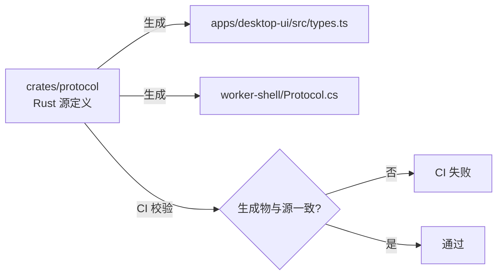

# OpenUnpack 系统重构方案

版本：1.0 · 2026-10-10 · 状态：方案（待评审）
适用范围：本仓库全量工程（Rust 核心 + .NET Worker + Tauri 宿主 + React UI + 既有 C#/WPF 遗留）
方法依据：绞杀者模式（Strangler Fig）+ 端口适配器（Hexagonal / Ports & Adapters）+ 契约优先（Contract-First）

---

## 摘要

现有系统功能完整，但工程结构停留在“按语言分层、按文件堆叠”的早期形态：业务逻辑、应用协调、基础设施与协议 DTO 全部挤在单一 crate `crates/core` 内，其中 `coordinator.rs` 已达 **2311 行**，同时承担状态机、调度、发布、校验、指纹、路径与清单七类职责；Tauri 宿主 `apps/desktop-host/src/lib.rs` 以 **1176 行** 承载 35+ 个命令；协议 DTO 在 Rust / TypeScript / C# 三处手工镜像；`src/OpenUnpack.Core`（C#）与 Rust 核心存在功能重叠的平行实现。

本方案的目标是把这套系统重构为**高内聚、低耦合、可插件化、可平滑升级**的模块化架构，核心决策如下：

| 决策 | 结论 |
|---|---|
| 架构风格 | 分层 + 端口适配器；核心内核稳定，业务模块可插拔 |
| 分层 | Domain → Application → Infrastructure；Protocol 作为跨边界共享契约；Presentation / Worker 作为适配器 |
| 边界划分 | **核心系统**（状态机、调度、存储事务、发布恢复、安全基座）与**业务模块**（密码库、扫描、引擎、校验、输出规则、工具箱）分离 |
| 通信 | 前端↔核心走 Tauri 版本化命令/事件；核心↔Worker 走私有命名管道版本化协议；模块↔模块只经 Application 端口（trait） |
| 扩展 | 三级插件策略（内置注册表 → 外部进程插件 → 沙箱化 WASM）；工具箱（压缩/复制移动/重命名/修复）作为首批试点 |
| 兼容 | 四类版本号独立演进：`appVersion` / `protocolVersion` / `schemaVersion` / `pluginApiVersion` |
| 迁移 | 6 个可独立回滚的波次（W0–W6），全程保留防腐层，新旧并存、逐个切换、绝不一次性重写 |

---

## 1. 现状诊断

### 1.1 代码规模与热点

| 文件 | 行数 | 承担的职责 | 问题定性 |
|---|---:|---|---|
| `crates/core/src/coordinator.rs` | 2311 | 状态机 + 任务调度 + 阶段推进 + 发布 + 校验 + 指纹 + 路径命名 + 清单生成 | **上帝对象**，跨 4 层职责 |
| `crates/core/src/vault.rs` | 1518 | DPAPI 加密 + 持久化 + 导入导出 + 候选解析 + 成功事件幂等 | 领域逻辑与基础设施耦合 |
| `apps/desktop-host/src/lib.rs` | 1176 | 35+ 个 `#[tauri::command]` + 窗口校验 + 路径净化 + 托盘 + 单实例锁 | **胖控制器** |
| `crates/core/src/scanner.rs` | 1020 | 递归扫描 + 分卷归组 + 排除匹配 + 输出命名 | 领域逻辑集中但可拆 |
| `crates/core/src/paths.rs` | 645 | 路径规范化 + 安全校验 | 基础设施关注点 |
| `crates/core/src/repository.rs` | 457 | SQLite 任务/发布/成功事件持久化 | 基础设施，尚可 |
| `crates/core/src/worker.rs` | 307 | Worker 进程生命周期 + 管道协议客户端 | 基础设施，尚可 |
| `crates/core/src/route.rs` | 284 | 缓存路由决策 | 领域规则 |
| `crates/core/src/types.rs` | 152 | 全部 DTO（领域 + 协议 + 视图混在一起） | **职责混合** |
| `crates/core/src/lib.rs` | 8 | 8 个平铺模块声明 | 无层次 |

### 1.2 结构性问题清单

| 编号 | 问题 | 证据 | 后果 |
|---|---|---|---|
| S1 | 单一 crate 混合四层 | `crates/core/src/` 下 domain/application/infrastructure/protocol 平铺 | 无法用编译期约束依赖方向；任何模块可引用任何模块 |
| S2 | 协议 DTO 三处手工镜像 | `types.rs`（源）↔ `apps/desktop-ui/src/types.ts` ↔ `src/OpenUnpack.Worker/Protocol.cs` | 字段漂移无编译期检测，改一处漏两处风险高 |
| S3 | 领域与框架耦合 | `types.rs` 直接派生 `Serialize/Deserialize`；`JobView` 混合持久化字段与 UI 展示字段 | 无法纯单元测试领域规则；UI 契约变更牵连持久化 |
| S4 | God Object | `coordinator.rs` 2311 行、`impl Coordinator` 覆盖 1650+ 行 | 单点修改风险高、并行开发冲突严重、无法局部替换 |
| S5 | C# 平行实现与死代码 | `src/OpenUnpack.Core/{VaultService,BatchRunner,ArchiveScanner,CacheRouteDecider,CacheWorkspace}.cs` 与 Rust 核心功能重叠；`src/OpenUnpack.Desktop`（WPF）为保留原型 | 语义分叉、维护双份、误改风险、构建时间浪费 |
| S6 | 胖控制器 | `lib.rs` 1176 行集中全部命令，直接持有 `Coordinator` 并调用 `vault()/scanner` | 权限/校验逻辑与业务命令混杂，难审计 |
| S7 | 无扩展机制 | 工具箱（压缩/复制/重命名/修复）无承载结构 | 新增能力必须改动核心，违反开闭原则 |
| S8 | 仓库顶层污染 | `gemini-subagent/`（2465 文件）、`target/`、`node_modules/`、`artifacts/`、`temp_reg.txt`、`test_out.txt` 与源码同级 | 源码包白名单易漏、误入版本控制、构建不可复现 |
| S9 | 无版本兼容机制 | 仅 `PROTOCOL_VERSION=1` 常量，无 schema 版本、无迁移不变量 | 升级无回滚保障，旧版可能误读新结构 |

> 诊断结论：本系统的**功能成熟度已领先工程结构**。重构的实质不是加功能，而是把已验证的业务能力迁入正确的边界，并补齐扩展与兼容机制。

---

## 2. 重构目标、原则与约束

### 2.1 目标（可验收）

1. **边界清晰**：任一模块的依赖只能指向同层或更内层，编译期即可强制（Rust crate 边界 + 依赖方向检查）。
2. **核心稳定**：核心系统（状态机/调度/事务/发布/安全）在业务模块演进时零改动。
3. **单一权威源**：协议 DTO、错误码、领域类型各只有一份定义，其余由代码生成或校验。
4. **可扩展**：新增工具箱能力无需改动核心；插件可独立升级。
5. **可平滑升级**：任何数据格式与协议变更都带版本号与迁移路径，失败可回退旧程序。
6. **可测试**：领域规则可在无 IO、无框架环境下纯单元测试。

### 2.2 设计原则

| 原则 | 含义 | 落地手段 |
|---|---|---|
| 依赖倒置 | 高层不依赖低层，两者依赖抽象 | Application 定义端口 trait，Infrastructure 实现 |
| 单一职责 | 一个模块只有一个变化的理由 | 按“变化的轴向”切分（见 §5） |
| 显式边界 | 跨边界必须经契约 | protocol crate + 端口 trait |
| 开闭原则 | 对扩展开放、对修改封闭 | 插件注册表 + 用例模块 |
| 契约版本化 | 一切跨进程/跨层契约带版本 | 四类版本号（见 §7.3） |
| 可回滚 | 每一步迁移都能退回 | 防腐层 + 特性开关 + 影子运行 |

### 2.3 约束（不可违反）

- 不得破坏既有已验收行为（见 `docs/acceptance-checklist.md`）。
- 口令永不进入命令行、环境变量、任务库、清单、日志或诊断包（沿用现有安全基线）。
- 源包与用户成品**不是**重构的删除对象。
- 迁移期间不得同时维护两套**活跃**的任务状态机（旧实现只能只读或转发）。
- 领域规则永不依赖 React / Tauri / SQLite / 7-Zip 原生引擎。

---

## 3. 目标架构分层

### 3.1 分层视图

```
┌─────────────────────────────────────────────────────────────┐
│ Presentation / Adapters（适配器层，可替换）                    │
│  apps/desktop-ui (React/TS/AntD)   apps/desktop-host (Tauri)  │
│  crates/archive-worker (进程管理)  native/engine-bridge (ABI) │
└───────────────▲───────────────────────────────▲─────────────┘
                │ 版本化命令/事件                 │ 私有命名管道协议
┌───────────────┴───────────────────────────────┴─────────────┐
│ Application（应用层：用例编排 + 端口定义）                     │
│  crates/application                                           │
│   · JobCoordinator（状态推进）  · UseCases（命令用例）          │
│   · Ports: IArchiveEngine, IVault, IJobRepository,            │
│     IWorkspace, IVerifier, IPublisher, IClock                 │
└───────────────▲───────────────────────────────▲─────────────┘
                │ 仅依赖抽象                     │
┌───────────────┴───────────────────────────────┴─────────────┐
│ Domain（领域层：纯逻辑，零框架依赖）                           │
│  crates/domain                                                │
│   · JobTree / ArchiveNode / Attempt（任务树与状态机）          │
│   · ConflictPolicy / NamingRule / StorageBudget（规则）        │
│   · VerificationScope / ErrorCode（领域枚举）                  │
└───────────────────────────────────────────────────────────────┘
                ▲  基础设施实现 Application 端口
┌───────────────┴───────────────────────────────────────────────┐
│ Infrastructure（基础设施层，可替换实现）                        │
│  crates/infrastructure                                         │
│   · SqliteJobRepository · DpapiVault · FsWorkspace             │
│   · StreamVerifier · AtomicPublisher · WorkerClient            │
└───────────────────────────────────────────────────────────────┘

跨边界共享（无业务逻辑，纯契约）：
  crates/protocol  —— 版本化 DTO + 错误码 + 类型生成入口(Rust/TS/C#)
```

### 3.2 依赖方向规则矩阵

行 = 允许依赖的发起方，列 = 允许依赖的目标（✓ 允许，✗ 禁止，— 无意义）。

| from \ to | domain | application | infrastructure | protocol | host | ui |
|---|:--:|:--:|:--:|:--:|:--:|:--:|
| **domain** | — | ✗ | ✗ | ✓(仅错误码) | ✗ | ✗ |
| **application** | ✓ | — | ✗ | ✓ | ✗ | ✗ |
| **infrastructure** | ✓ | ✓(仅端口) | — | ✓ | ✗ | ✗ |
| **protocol** | ✗ | ✗ | ✗ | — | ✗ | ✗ |
| **host(Tauri)** | ✗ | ✓ | ✓(装配) | ✓ | — | ✗ |
| **ui(React)** | ✗ | ✗ | ✗ | ✓(生成 TS) | — | — |
| **worker** | ✗ | ✗ | ✗ | ✓ | — | ✗ |

关键约束：
- `domain` **绝不**依赖 `application`/`infrastructure`/框架。
- `application` 只依赖 `domain` 与 `protocol`，通过端口调用基础设施（编译期看不到 SQLite/DPAPI）。
- `infrastructure` 依赖端口定义而非反向。
- `worker` 与主程序只共享 `protocol`，不共享 Vault 持久化权限。

### 3.3 目标目录映射

| 现状 | 目标 | 动作 |
|---|---|---|
| `crates/core/src/types.rs`（全部 DTO） | `crates/protocol`（跨边界 DTO + 错误码）+ `crates/domain`（领域类型） | 拆分 |
| `crates/core/src/coordinator.rs` | `crates/application`（编排）+ `crates/domain`（状态机/规则） | 按职责分解 |
| `crates/core/src/vault.rs` | `crates/infrastructure/vault`（DPAPI+持久化）+ `crates/application`（候选策略） | 分层拆分 |
| `crates/core/src/repository.rs` | `crates/infrastructure/repository` | 平移 |
| `crates/core/src/scanner.rs` | `crates/domain`（分卷/排除规则）+ `crates/infrastructure`（IO） | 分层拆分 |
| `crates/core/src/paths.rs` / `route.rs` | `crates/domain`（规则）+ `crates/infrastructure/fs`（IO） | 分层拆分 |
| `crates/core/src/worker.rs` | `crates/infrastructure/engine`（客户端）+ `crates/archive-worker`（生命周期） | 平移/拆分 |
| `apps/desktop-host/src/lib.rs`（35+ 命令） | 拆为 `commands/*.rs` + 装配 `bootstrap.rs` | 拆分 |
| `src/OpenUnpack.Worker` | 保留为 `worker-shell`（.NET 引擎宿主，走 protocol） | 保留，去重 |
| `src/OpenUnpack.Core`（C# 平行实现） | 退役（迁移后删除） | **删除**（W6） |
| `src/OpenUnpack.Desktop`（WPF 原型） | 退役 | **删除**（W6） |
| `gemini-subagent/`、`target/`、`artifacts/`、`temp_*.txt` | 移出仓库或加入 `.gitignore` / 源码白名单 | 清理（W0） |

---

## 4. 核心系统与业务模块边界

**划分依据**：以“**变化的轴向**”切分——核心系统对业务需求保持不变，业务模块随需求频繁演进。

### 4.1 核心系统（Core Kernel，稳定）

| 核心子系统 | 职责 | 变化频率 | 拥有的数据 |
|---|---|---|---|
| 任务状态机 | 排队→检查→预留→解压→封存→写回→校验→发布→完成 的合法转移、前置条件、幂等操作 ID | 低 | 状态枚举、转移规则 |
| 资源调度 | 物理盘 / CPU / 内存 / 缓存额度的整组准入与释放；无循环等待 | 低 | 许可租约、等待图 |
| 存储与事务 | SQLite 单写入者、short transaction、schema 版本 | 低 | 任务/节点/尝试/发布/outbox |
| 发布与恢复 | 目标卷临时目录、非覆盖改名、发布意图、崩溃恢复矩阵 | 低 | 发布意图、归属标记 |
| 安全基座 | DPAPI 全库加密、命名管道 ACL、路径净化、口令不外泄 | 低 | 密钥访问、ACL 策略 |
| 协议与契约 | 版本化 DTO、错误码、类型生成 | 中 | protocol 定义 |

> 核心系统的稳定是整套架构的承重墙：业务模块可以替换，核心状态机与提交点不可随意改动。

### 4.2 业务模块（Business Modules，可演进/可插拔）

| 业务模块 | 职责 | 对外端口 | 可插拔性 |
|---|---|---|---|
| 密码库（Vault） | 分组、导入、备份、候选解析、成功关联 | `IVault` | 可替换存储后端 |
| 扫描与分卷（Scanner） | 递归发现、去重、分卷归组、排除 | `IScanner`（新增端口） | 可替换 |
| 引擎适配（Engine） | extract/copy/readback、错误映射 | `IArchiveEngine` | 可换 7-Zip / 其他引擎 |
| 校验策略（Verifier） | 标准流式 / 目标回读 / 引擎内建码 | `IVerifier` | 可扩展新策略 |
| 输出规则（OutputRules） | 冲突策略、命名、排除、单根展开 | `IOutputPlanner` | 可扩展规则 |
| 工具箱（Toolbox）**（新增）** | 批量压缩、复制移动、重命名、类型修复 | `IToolPlugin` | **插件化试点** |
| UI 页面 | 四页主界面 + 设置 | Tauri 命令 | 可拆分为独立视图包 |

### 4.3 边界界定规则（判定某能力属于核心还是业务）

1. **不变量测试**：若该能力缺失会导致数据损坏、口令泄露或不可恢复，则属于**核心**。
2. **替换测试**：若该能力可以被另一种实现完全替换而不影响任务正确性，则属于**业务**。
3. **变化频率测试**：若半年内更可能因产品需求变化，则属于**业务**。
4. **数据所有权测试**：每个模块独占自己的数据，跨模块只能经端口取用，不得共享可变状态。

---

## 5. 模块划分原则（高内聚、低耦合）

### 5.1 内聚原则

| 原则 | 说明 | 反例（现状） |
|---|---|---|
| 功能内聚 | 模块内所有元素服务于同一职责 | `coordinator.rs` 混入路径命名与指纹计算 |
| 数据内聚 | 模块独占其数据并提供访问端口 | Vault 与 Repository 混在 core 平铺 |
| 变化内聚 | 会一起变化的放在一起，不会一起变化的拆开 | `JobView` 混合持久化字段与 UI 字段 |
| 契约内聚 | 跨边界 DTO 集中定义、集中生成 | DTO 三处手工镜像 |

### 5.2 耦合管控

| 目标 | 手段 |
|---|---|
| 消除内容耦合 | 禁止模块间直接访问对方内部结构；只经端口 |
| 降低公共耦合 | 禁止全局可变单例；`Coordinator` 拆为用例 + 领域，状态经仓储 |
| 抑制控制耦合 | 端口方法语义单一，不传“模式标志”让实现分支 |
| 禁止循环依赖 | crate 依赖图单向；CI 用 `cargo tree` + 自研守卫脚本校验 |
| 隔离时间耦合 | 长时操作交执行器，消息回合不等待（沿用现有防死锁规则，见 `architecture-modern.md` §15） |

### 5.3 标准接口规范（端口契约模板）

所有端口遵循统一形态：

```rust
// crates/application/src/ports.rs（示意，非最终签名）
pub trait IArchiveEngine: Send + Sync {
    /// 幂等：相同 operation_id 重复调用返回同一结果
    fn extract(&self, req: ExtractRequest, cx: &OperationContext) -> Result<NodeResult, EngineError>;
    fn cancel(&self, operation_id: &str) -> Result<(), EngineError>;
}

pub struct OperationContext {
    pub operation_id: String,
    pub generation: u64,           // 运行代次，防止过期消息推进
    pub cancel: CancellationToken, // 协作取消
    pub deadline: Option<Instant>,
}
```

规范要点：
- 所有跨端口方法**幂等**，携带 `operation_id` 与 `generation`。
- 错误为**类型化枚举**（复用 `ErrorCode`），不含原始异常文本与口令。
- 长时操作接收 `OperationContext`（取消令牌 + 代次 + 期限）。
- 端口方法**同步签名**，异步由实现层封装；禁止跨 await 持锁。

---

## 6. 模块间通信与依赖管理

### 6.1 三条通信边界

| 边界 | 机制 | 契约 | 版本控制 |
|---|---|---|---|
| 前端 ↔ 核心 | Tauri 命令（类型化）+ 事件通道（快照/阶段） | `crates/protocol` 生成 TS 类型 | `protocolVersion` |
| 核心 ↔ Worker | 私有命名管道（`CurrentUserOnly`，控制/数据双通道） | 换行 JSON `WorkerRequest`/`WorkerEvent` | `protocolVersion`（现为 1） |
| 模块 ↔ 模块 | Application 端口（trait）+ 装配点注入 | 端口契约 | 随 app 版本 |

### 6.2 通信设计原则

1. **控制与数据分离**：取消/探测走独立控制通道，不被大清单或进度洪泛阻塞（沿用现有设计）。
2. **快照 + 增量事件**：UI 重连先拉快照，再消费更高序号事件，不靠漏失通知重建状态。
3. **进度合并**：普通进度每 100–200ms 合并刷新；阶段/错误立即通知。
4. **消息有界**：长度上限 + 分帧；海量条目分批或落成核心验证的清单。
5. **不信任输入**：跨边界数据一律校验格式/长度/权限/前置条件；原始异常与文件名视为数据。

### 6.3 依赖管理方案

| 关注点 | 方案 |
|---|---|
| 依赖注入 | 单一装配点（composition root）：`apps/desktop-host/src/bootstrap.rs` 负责把 Infrastructure 实现注入 Application 用例 |
| 依赖方向守护 | CI 步骤：`cargo tree -e normal` 校验依赖图；自定义脚本检测 domain→framework 违规 |
| 循环依赖 | crate 单向依赖天然阻断；端口回调用特型而非反向 crate 依赖 |
| 第三方依赖 | 精确锁定（`Cargo.lock`/`package-lock.json`）；`cargo deny` 检查许可证与漏洞；MSRV 声明 |
| 类型生成 | 由 `crates/protocol` 作为唯一源，生成 TS（ts-rs / 手工同步脚本 + CI 校验）与 C#（必要时） |
| 契约测试 | 协议兼容性测试：旧版 DTO 能解析新版消息的可选字段，反之拒绝不支持版本 |

### 6.4 协议漂移治理（针对 S2）



- 引入生成步骤（ts-rs 或等价），把 `types.ts` 从“手工镜像”改为“生成物”。
- C# Worker 的 `Protocol.cs` 同理，可先用“CI 校验字段一致性”过渡，再完全生成。
- 任何协议字段变更必须同时更新源定义并触发再生成，否则 CI 阻断。

---

## 7. 扩展性设计

### 7.1 插件化扩展（工具箱试点）

工具箱是首个天然的插件化落点（批量压缩 / 复制移动 / 批量重命名 / 类型修复）。采用**三级插件策略**，按隔离强度递增、按成本递增：

| 级别 | 形态 | 隔离 | 适用 | 成本 |
|---|---|---|---|---|
| L1 内置模块 | 核心内置 `ToolModule` 注册表 | 无（同进程） | 稳定、可信、与核心共享数据 | 低 |
| L2 外部进程插件 | 子进程 + 版本化协议（复用 Worker 模式） | 进程级 | 需要独立崩溃隔离、可独立升级 | 中 |
| L3 沙箱插件 | WASM / 受限令牌 | 强 | 未来第三方开放 | 高 |

**推荐**：首版落 **L1 + L2**，L3 保留接口不实现。

插件契约（示意）：

```rust
// crates/application/src/plugin.rs
pub trait IToolPlugin: Send + Sync {
    fn manifest(&self) -> &PluginManifest;                 // id, name, api_version, capabilities
    fn capabilities(&self) -> &[Capability];               // 声明权限：读源/写工作区/调引擎
    fn run(&self, input: ToolInput, cx: &OperationContext) -> Result<ToolOutput, PluginError>;
}

pub struct PluginManifest {
    pub id: String,
    pub name: String,
    pub api_version: u32,      // pluginApiVersion
    pub entry: PluginEntry,    // Builtin / ExternalProcess{path} / Wasm{module}
    pub capabilities: Vec<Capability>,
}
```

插件规则：
- 插件**只能**经声明能力访问资源，未声明即拒绝（最小权限）。
- 外部插件运行在独立进程树（Job Object），核心持有生命周期。
- 插件不得直接写任务数据库或最终发布目录；发布仍由核心独占。
- 首版不开放任意第三方代码加载（与 `architecture-modern.md` 一致）。

### 7.2 平滑升级机制

| 升级对象 | 机制 |
|---|---|
| 应用版本 | 双版本共存安装；数据目录带 `schemaVersion`；升级前自动备份 vault 与 tasks.db |
| 数据库 schema | 前向迁移脚本 + `SchemaVersion` 表；旧程序读到不支持版本**拒绝写入**（不降级） |
| 协议 | 新增字段一律可选 + 默认值；旧版能解析新版；新版对旧版缺失字段给默认 |
| 发布流程 | 4 步可恢复（意图→临时目录→标记→改名→提交），每个窗口可强制退出恢复 |
| 回滚 | 保留迁移前备份；成品与源包不作回滚删除对象；旧程序可继续读旧数据 |

### 7.3 版本兼容机制（四类版本号独立演进）

| 版本号 | 管辖范围 | 变更影响 | 兼容规则 |
|---|---|---|---|
| `appVersion` | 产品整体 | 全量 | 语义化版本 |
| `protocolVersion` | 前端↔核心、核心↔Worker 消息 | 跨进程契约 | 新版↔旧版需契约测试；不兼容则拒绝 |
| `schemaVersion` | vault.dat / tasks.db / manifest | 持久化格式 | 只前向迁移；不支持版本拒绝写入 |
| `pluginApiVersion` | 插件 ABI | 插件生态 | 插件声明所需版本，核心校验区间 |

兼容判定矩阵（示例）：

| 场景 | 允许 | 处理 |
|---|---|---|
| 新版程序 + 旧版数据库 | ✓ | 自动迁移，写前备份 |
| 旧版程序 + 新版数据库 | ✗ | 拒绝写入，提示升级或回退 |
| 新版前端 + 旧版核心（同包内不会发生） | — | 版本握手校验 |
| 新版核心 + 旧版 Worker | ✓ | `protocolVersion` 握手，能力降级 |
| 插件 api 版本过新 | ✗ | 拒绝加载，提示 |

---

## 8. 渐进式迁移路径（绞杀者模式）

**总原则**：新旧并存 → 防腐层隔离 → 逐个切换 → 验证通过再删旧。**绝不一次性重写**，每一步可独立回滚。

### 8.1 波次规划

| 波次 | 目标 | 关键动作 | 验收门槛 | 回滚点 |
|---|---|---|---|---|
| **W0 冻结与基线** | 建立保护网 | 冻结既有行为；补齐关键契约测试与金丝雀样本；清理仓库顶层污染；`.gitignore` 与源码白名单校正 | 全量测试绿；源码包白名单可复现 | 无（无功能改动） |
| **W1 协议提取** | 消除 DTO 漂移 | 抽 `crates/protocol`；`types.ts`/`Protocol.cs` 改为生成/校验；CI 加漂移检测 | 生成物与源一致；契约测试通过 | 生成失败可回退手工文件 |
| **W2 端口化** | 依赖倒置 | 在 `crates/application` 定义端口；Infrastructure 实现；装配点注入 | 依赖方向检查通过；行为不变 | 端口可暂时委托旧实现 |
| **W3 拆解上帝对象** | 降低单点风险 | 把 `coordinator.rs` 拆为 domain 状态机 + application 用例 + infrastructure 发布器 | 全部任务场景回归通过；行数分散 | 保留旧 coordinator 作防腐层转发 |
| **W4 crate 物理拆分** | 编译期强制边界 | 落地 `crates/{domain,application,infrastructure}`；`crates/core` 变薄壳转发 | `cargo tree` 校验通过；无违规依赖 | 旧 crate 保留为 re-export |
| **W5 插件框架** | 开闭扩展 | 落地 `IToolPlugin` + 注册表；工具箱试点 L1；L2 外部进程插件验证 | 新增插件零改动核心；插件权限受控 | 插件可通过开关禁用 |
| **W6 退役旧代码** | 收敛维护面 | 删除 `src/OpenUnpack.Core`（C# 重复）、`src/OpenUnpack.Desktop`（WPF 原型）；移除 `crates/core` 薄壳 | 构建产物无回归；仓库规模下降 | 保留 git 历史可恢复 |

### 8.2 防腐层示意（W3–W4 期间）

```
新调用方 ──► crates/application（新用例）
                     │
                     ▼
          旧 CoordinatorAdapter（防腐层，转发到 crates/core）
                     │
                     ▼
              旧 coordinator.rs（只读/转发，逐步被替换）
```

- 新代码只依赖新端口；旧实现通过适配器被包裹。
- 每完成一个用例的切换，就把该用例从适配器移除；适配器最终消失即重构完成。
- 特性开关控制“走新路径 / 走旧路径”，可灰度。

### 8.3 降低业务风险的保障措施

| 措施 | 作用 |
|---|---|
| 特性开关（feature flag） | 新旧路径可运行时切换，问题可秒级回退 |
| 影子运行（shadow） | 新实现与旧实现并行计算，比对结果差异但不提交 |
| 契约测试 + 金丝雀样本 | 真实归档样本集（ZIP/7z/RAR/分卷/嵌套/不同密码）作为回归网 |
| 分阶段发布 | 每个波次独立版本、独立验收、独立回滚 |
| 数据备份门禁 | 涉及 schema/vault 的波次，升级前强制备份 |
| 只读降级 | 迁移期旧实现只允许只读，避免双写分叉 |

---

## 9. 风险登记与缓解（P0 / P1 / P2）

| 级别 | 风险 | 潜在后果 | 缓解方案 |
|---|---|---|---|
| **P0** | 迁移期新旧状态机双写分叉 | 任务状态损坏、发布重复/丢失 | 旧实现只读；单写入者原则；影子运行只比对不提交 |
| **P0** | 重构破坏已验收的安全边界（口令外泄/路径穿越） | 严重安全事件 | 安全基座（DPAPI/ACL/路径净化）保持不动；安全回归测试门禁 |
| **P0** | 数据格式变更导致升级不可逆 | 用户数据丢失 | schemaVersion + 迁移前强制备份 + 前向迁移 + 拒绝降级写入 |
| **P1** | 拆解 `coordinator.rs` 引入行为回归 | 解压流程错误 | 先补全场景回归测试再拆；防腐层转发；灰度切换 |
| **P1** | 协议生成引入构建复杂度 | CI 脆弱、开发受阻 | 生成失败可回退手工文件；生成步骤幂等可复现 |
| **P1** | 插件越权访问核心数据 | 数据破坏/泄露 | 能力声明 + 最小权限 + 外部插件进程隔离 |
| **P2** | crate 拆分增加依赖管理成本 | 编译时间与理解成本上升 | 依赖图守护脚本；文档化边界；渐进拆分 |
| **P2** | 仓库清理误删有用文件 | 误删风险 | 清理走白名单 + git 历史 + 分批确认（遵循个人文件安全规则） |

---

## 10. 落地路线图

### 短期（0–4 周）：打好地基，零行为变更

1. **W0 冻结与基线**：补契约测试与金丝雀样本；顶层目录清理（`gemini-subagent/`、`target/`、`artifacts/`、`temp_*.txt` 归位或忽略）。
2. **W1 协议提取**：`crates/protocol` 落地；`types.ts` 转生成物；CI 加漂移检测。
3. 产出：依赖方向守卫脚本、契约测试流水线、源码包可复现。

### 中期（4–12 周）：拆解核心，建立边界

4. **W2 端口化**：定义 `IArchiveEngine/IVault/IJobRepository/IWorkspace/IVerifier/IPublisher`；装配点注入。
5. **W3 拆解 God Object**：`coordinator.rs` 按 domain/application/infrastructure 三向分解，防腐层托管。
6. **W4 crate 拆分**：物理落地 `domain/application/infrastructure`，`crates/core` 退化为薄壳。
7. 产出：编译期强制的依赖边界、可纯单元测试的领域层。

### 长期（12 周+）：开放扩展，收敛维护面

8. **W5 插件框架**：`IToolPlugin` + 注册表；工具箱 L1 试点，L2 外部进程插件验证。
9. **W6 退役旧代码**：删除 C# 重复实现与 WPF 原型；移除薄壳。
10. 产出：可插件化的工具箱、单一的权威实现、显著降低的维护面。

---

## 附录 A：契约版本清单

| 契约 | 常量/位置 | 当前值 | 变更策略 |
|---|---|---|---|
| 协议版本 | `PROTOCOL_VERSION`（移入 protocol） | 1 | 握手校验 + 契约测试 |
| 数据库 schema | `SchemaVersion` 表（移入 infrastructure） | 待补 | 前向迁移 + 拒绝降级 |
| 密码库格式 | `vault.dat` 头部版本 | 待补 | 备份 + 迁移 |
| 清单格式 | `manifestId` + 内容摘要 | 待补 | 不可变证据 |
| 插件 ABI | `pluginApiVersion` O | 待定 | 声明区间校验 |

## 附录 B：现状 → 目标 对照速查

| 层 | 现状 | 目标 |
|---|---|---|
| 领域 | 混在 `crates/core` | `crates/domain`（零依赖） |
| 应用 | `coordinator.rs` 巨型对象 | `crates/application`（用例 + 端口） |
| 基础设施 | 与领域同 crate | `crates/infrastructure`（实现端口） |
| 协议 | `types.rs` 三处镜像 | `crates/protocol`（单源 + 生成） |
| 宿主 | 单文件 35+ 命令 | 按域拆分的 `commands/*` + `bootstrap` |
| Worker | C# + Rust 客户端分散 | `crates/archive-worker` + `worker-shell` 走统一协议 |
| 遗留 | C# Core / WPF 平行实现 | 退役删除 |
| 扩展 | 无 | 内置注册表 + 外部进程插件 |

---

> 本方案只调整工程结构与契约，不改动已验收的业务行为。所有迁移波次均可独立回滚；核心系统与安全基座在重构期间保持稳定。实际落地需以真实归档样本回归、依赖方向检查与安全测试结果为准，不以编译成功替代验收。
