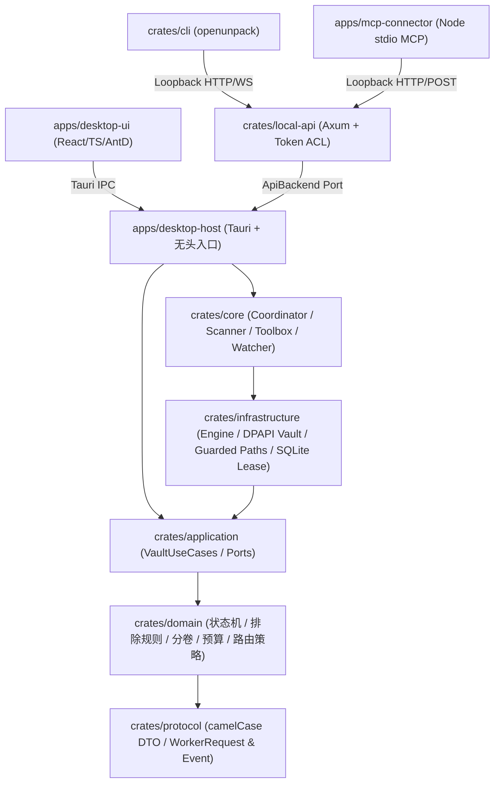
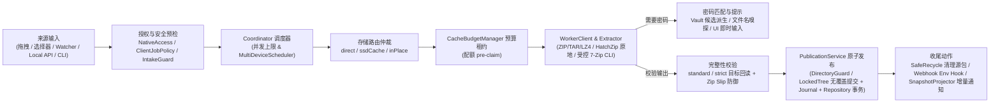

# OpenUnpack 详细技术文档（模块与文件全量索引）

> **适用基线**：Windows x64 仓库主线（纯 Rust 微内核 + Tauri v2 桌面宿主 + React 19 / Ant Design v6 前端 + Node.js MCP 连接器 + 官方 7-Zip CLI 受控引擎）。  
> **文档范围**：说明系统分层架构、跨层/跨进程数据流，并按目录层级逐一标明仓库内全量核心模块与文件的位置与职责。

---

## 目录

- [1. 项目概览与技术栈](#1-项目概览与技术栈)
- [2. 系统分层架构与核心链路](#2-系统分层架构与核心链路)
  - [2.1 分层依赖拓扑（DAG）](#21-分层依赖拓扑dag)
  - [2.2 解压与发布核心链路](#22-解压与发布核心链路)
  - [2.3 唯一实现与兼容再导出契约](#23-唯一实现与兼容再导出契约)
- [3. 根目录配置、工程规范与 CI/CD](#3-根目录配置工程规范与-cicd)
- [4. Rust Workspace 模块与文件清单（`crates/`）](#4-rust-workspace-模块与文件清单crates)
  - [4.1 `crates/protocol` — 跨层与跨进程通信契约](#41-cratesprotocol--跨层与跨进程通信契约)
  - [4.2 `crates/domain` — 纯领域模型与业务策略](#42-cratesdomain--纯领域模型与业务策略)
  - [4.3 `crates/application` — 端口定义与用例编排](#43-cratesapplication--端口定义与用例编排)
  - [4.4 `crates/infrastructure` — 底层安全 IO、引擎、Vault 与适配器](#44-cratesinfrastructure--底层安全-io引擎vault-与适配器)
  - [4.5 `crates/core` — 唯一权威编排器、扫描器、工具箱与监控](#45-cratescore--唯一权威编排器扫描器工具箱与监控)
  - [4.6 `crates/local-api` — 鉴权本机 HTTP / WebSocket API](#46-crateslocal-api--鉴权本机-http--websocket-api)
  - [4.7 `crates/cli` — 独立命令行客户端（`openunpack`）](#47-cratescli--独立命令行客户端openunpack)
- [5. 上层应用模块与文件清单（`apps/`）](#5-上层应用模块与文件清单apps)
  - [5.1 `apps/desktop-host` — Tauri v2 桌面宿主与无头守护进程](#51-appsdesktop-host--tauri-v2-桌面宿主与无头守护进程)
  - [5.2 `apps/desktop-ui` — React / TypeScript / Ant Design 前端](#52-appsdesktop-ui--react--typescript--ant-design-前端)
  - [5.3 `apps/mcp-connector` — 本地 stdio MCP 服务器连接器](#53-appsmcp-connector--本地-stdio-mcp-服务器连接器)
- [6. 脚本工具链、审计门禁与外围资产](#6-脚本工具链审计门禁与外围资产)
  - [6.1 `scripts/` — 构建、验证、契约/架构/规范门禁与下载器集成](#61-scripts--构建验证契约架构规范门禁与下载器集成)
  - [6.2 `tests/`、`assets/`、`examples/` 与 `docs/`](#62-testsassets-examples-与-docs)

---

## 1. 项目概览与技术栈

**OpenUnpack（解压工坊）** 是面向 Windows x64 的本地批量归档解压与加密密码库管理桌面软件。核心设计目标是：在高延迟机械硬盘（HDD）与高速固态硬盘（SSD）混合存储、多层嵌套压缩包、分卷归档与分散密码管理场景下，以**单栈 Rust 微内核**提供事务化队列调度、本地 DPAPI 凭据保护、SSD 按需中转加速、防劫持目录锁及原子校验发布能力，并通过 Tauri 桌面客户端、无头 HTTP/WS 守护进程（`--headless`）、独立 CLI 及 MCP 连接器向外暴露统一能力。

| 技术维度 | 选型与运行角色 | 核心文件位置 |
|---|---|---|
| 核心运行时与宿主 | Rust 2024 Edition、Tokio 异步运行时、Tauri v2（WebView2） | `Cargo.toml`、`crates/*`、`apps/desktop-host/` |
| 任务/状态持久化 | SQLite + OS 级文件租约（`DatabaseLease`） | `crates/core/src/repository.rs`、`crates/infrastructure/src/sqlite/database_lease.rs` |
| 解压执行引擎 | 纯 Rust（ZIP / TAR / LZ4 / HatchZip 原地截断引擎）+ 受控官方 7-Zip CLI（stdin 传密、`CREATE_NO_WINDOW`、Job Object 监管） | `crates/infrastructure/src/engine/`、`tools/7zip/` |
| 凭据安全存储 | Windows DPAPI + AES-256-GCM 独立口令备份 + 可选便携模式 `.vault.key` | `crates/infrastructure/src/dpapi/` |
| 前端界面框架 | React 19 + TypeScript 5.9 + Ant Design v6 + Vite 7 + Vitest 5 | `apps/desktop-ui/` |
| 本机 API 与文档 | Axum HTTP / WebSocket + Utoipa OpenAPI 3 + 内嵌 Swagger UI | `crates/local-api/` |
| 外部客户端生态 | 独立 Rust CLI（`openunpack`）与 Node.js stdio MCP Connector（Zod 校验） | `crates/cli/`、`apps/mcp-connector/` |
| 质量与合规门禁 | Workspace Clippy / Rustfmt、ESLint / Prettier、DTO 契约校验、依赖所有权门禁、代码规模门禁、源码发行审计 | `scripts/` |

---

## 2. 系统分层架构与核心链路

### 2.1 分层依赖拓扑（DAG）

OpenUnpack 通过 `scripts/check-architecture.mjs` 强制约束真实的 Cargo 编译依赖方向，禁止下层反向引用 `core` 或绕过本机 API 边界：

- **单生产权威**：所有队列变更、并发调度、预算控制与原子发布由 `crates/core/src/coordinator/` 唯一驱动，前端 UI 与外部 API 均只作投影与授权转发。
- **独立客户端边界**：`crates/cli` 与 `apps/mcp-connector` 仅依赖外围协议/契约与 `crates/local-api`，禁止直连 `crates/core` 或 SQLite。

### 2.2 解压与发布核心链路

### 2.3 唯一实现与兼容再导出契约

为了收敛历史重构路径并保持外部引用一致，`crates/core` 中保留少量**只做再导出（Bridge）**的模块，具体唯一真源如下表（由 `scripts/check-architecture.mjs` 自动审计）：

| 能力领域 | 唯一真实实现位置 | 只读再导出兼容桥 |
|---|---|---|
| 任务编排与三大私有组件 | `crates/core/src/coordinator/`（`CacheBudgetManager` / `SnapshotProjector` / `PublicationService`） | — |
| 任务、发布日志与 Outbox 事务 | `crates/core/src/repository.rs` | — |
| 排除通配符与单根/分卷纯规则 | `crates/domain/src/archive/` | `core::scanner`、`infra::engine::path_safety` 仅委托调用 |
| 安全路径边界、句柄锁与 `relative()` | `crates/infrastructure/src/paths.rs` 及 `paths/*` | `crates/core/src/paths.rs` |
| DPAPI / 便携密码库 `Vault` | `crates/infrastructure/src/dpapi/vault.rs` 及 `vault/*` | `crates/core/src/vault.rs` |
| 进程外/微内核 Worker 执行客户端 | `crates/infrastructure/src/worker/client.rs` | `crates/core/src/worker.rs` |
| Worker spill 清单解析 | `crates/infrastructure/src/worker/manifest.rs` | — |
| SQLite 进程租约 `DatabaseLease` | `crates/infrastructure/src/sqlite/database_lease.rs` | `crates/core/src/database_lease.rs` |
| 存储路由与磁盘拓扑 | `crates/infrastructure/src/route.rs` | `crates/core/src/route.rs` |
| 受控回收与 ACL 校验 | `crates/infrastructure/src/saferecycle.rs`、`recycle_shell.rs` | `crates/core/src/saferecycle.rs` |

---

## 3. 根目录配置、工程规范与 CI/CD

| 位置 | 功能职责 |
|---|---|
| `Cargo.toml` | Rust Workspace 定义（包含 7 个 `crates/*` 与 `apps/desktop-host`）、全局统一依赖版本及 `[workspace.lints]`（禁止 `dbg!`/`todo!`/`unimplemented!`，要求 `unsafe_op_in_unsafe_fn`）。 |
| `Cargo.lock` | 锁定全工作区 Cargo 依赖版本树，支持 `--locked` 可复现构建与审计。 |
| `rust-toolchain.toml` | 固定构建所需的 Rust 工具链渠道与组件版本（如 `rustfmt`、`clippy`）。 |
| `rustfmt.toml` | 定义全局 Rust 代码格式化规则（行宽 100 等）。 |
| `.prettierrc` / `.prettierignore` | 定义全前端与 Node 脚本 Prettier 规范（行宽 100、单引号、分号）及忽略路径清单（`gen/`、`assets/`、`fixtures/` 等）。 |
| `.editorconfig` | 统一跨编辑器的缩进、字符集与换行符约定。 |
| `.gitattributes` | 配置 Git 仓库文本/二进制文件的换行归一化规则（如 `.ps1`/`.bat`/`.rs`/`.ts` 等）。 |
| `.gitignore` | 忽略构建缓存、`target/`、`node_modules/`、`artifacts/`、密钥数据库等非受控文件。 |
| `AGENTS.md` | Agent 协作与工程交接规范说明。 |
| `README.md` | 项目面向最终用户与贡献者的主页说明（特性概览、系统要求、源码构建与安全模型）。 |
| `CONTRIBUTING.md` | 贡献指南、跨栈修改同步规范、架构约束、第 5.3 节编码规范及提交信息约定。 |
| `CHANGELOG.md` | 版本变更日志。 |
| `CODE_OF_CONDUCT.md` | 开源社区行为准则。 |
| `SECURITY.md` | 漏洞报告政策与 DPAPI/本机 API 安全边界说明。 |
| `THIRD_PARTY_NOTICES.md` | 第三方组件（7-Zip、Swagger UI 等）开源许可声明。 |
| `LICENSE` | 本项目 MIT 开源许可证正文。 |
| `.github/workflows/windows.yml` | 主 CI 验证流水线：运行 Windows 环境下的测试、契约、架构与安全门禁。 |
| `.github/workflows/release-build.yml` | 确定性发布打包流水线：产出桌面安装包、便携包与源码归档校验清单。 |
| `.github/ISSUE_TEMPLATE/bug_report.yml` | 缺陷报告 Issue 表单模板（含禁传 Vault/真实密码安全须知）。 |
| `.github/ISSUE_TEMPLATE/feature_request.yml` | 功能建议 Issue 表单模板。 |
| `.github/ISSUE_TEMPLATE/config.yml` | GitHub Issue 模板路由配置（禁用空白 Issue）。 |
| `.github/pull_request_template.md` | Pull Request 提交自检清单模板。 |

---

## 4. Rust Workspace 模块与文件清单（`crates/`）

### 4.1 `crates/protocol` — 跨层与跨进程通信契约

**作用**：零业务逻辑，统一定义与 TypeScript/OpenAPI 对齐的 `camelCase` 序列化 DTO 及 `WorkerRequest`/`WorkerEvent` 协议；所有含敏感口令的字段在 `Drop` 时执行 `zeroize`，`Debug` 实现自动脱敏。

| 文件位置 | 功能职责 |
|---|---|
| `crates/protocol/Cargo.toml` | Crate 清单，声明 `openapi` 可选 feature（生成 `utoipa` schema）及序列化依赖。 |
| `crates/protocol/src/lib.rs` | Crate 入口，定义密码候选 `Candidate`（Drop 清零 + Debug 脱敏）与密码命中回写事件 `SuccessEvent`。 |
| `crates/protocol/src/desktop.rs` | 桌面前端 / `local-api` 共享 DTO：`Settings`、`JobView`、`NodeView`、`AppSnapshot`、`SnapshotUpdate`/`Delta`、密码视图与导入预览、工具箱选项等（33 个核心类型受 `check-contracts` 双向核对）。 |
| `crates/protocol/src/worker.rs` | 执行器协议契约：`WorkerRequest` / `WorkerEvent`（v1/v2 版本协商、嵌套档案指令、`FileRecord` 列表与阶段事件）。 |
| `crates/protocol/src/error.rs` | 稳定跨进程错误码枚举（`as_str` 短名线格式契约，避免模糊字符串归类）。 |
| `crates/protocol/examples/contract_samples.rs` | 导出 19 个 Rust 协议样本 JSON 供前端与契约测试脚本交叉验证。 |
| `crates/protocol/tests/golden_samples.rs` | 协议黄金样本与错误码/settings/progress 往返序列化回归测试。 |
| `crates/protocol/tests/snapshot_delta.rs` | `SnapshotUpdate` 增量协议与十进制 revision 线格式测试。 |
| `crates/protocol/tests/snapshot_revision.rs` | 增量版本号 `u64` 字符串规范化与非法输入拒收测试。 |

---

### 4.2 `crates/domain` — 纯领域模型与业务策略

**作用**：完全无 IO、纯函数实现的业务模型与领域不变式层。

| 文件位置 | 功能职责 |
|---|---|
| `crates/domain/Cargo.toml` | Crate 清单（仅依赖 `protocol`、`serde`、`thiserror`、`zeroize`）。 |
| `crates/domain/src/lib.rs` | Crate 入口与常用领域类型/函数再导出，附状态转换矩阵单元测试。 |
| `crates/domain/src/error.rs` | 领域错误枚举 `DomainError`（状态机非法转移、预算超限、路径越界、分卷校验失败等）。 |
| `crates/domain/src/archive/mod.rs` | 归档领域子模块出口，声明通配符与分卷单一规则真源。 |
| `crates/domain/src/archive/exclusions.rs` | 全仓唯一权威的输入/输出排除与包含通配符匹配引擎（大小写折叠与路径锚定一致）。 |
| `crates/domain/src/archive/grouping.rs` | 分卷命名识别与 `VolumePattern` 解析。 |
| `crates/domain/src/archive/naming.rs` | 同名冲突改名（追加 `_1`、`_2`）及单层顶层目录去套娃判定（`should_unwrap_single_root`）。 |
| `crates/domain/src/jobs/mod.rs` | 任务领域子模块出口。 |
| `crates/domain/src/jobs/model.rs` | 任务聚合根 `JobAggregate` 与递归节点 `NodeAggregate` 模型。 |
| `crates/domain/src/jobs/options.rs` | 入队时冻结的不可变选项快照，使用 `extensions` 兼容未知未来字段。 |
| `crates/domain/src/jobs/state_machine.rs` | 权威任务生命周期状态 `JobStatus`、合法转移矩阵（`can_transition_to`）与执行阶段 `ExecutionStage`。 |
| `crates/domain/src/passwords/mod.rs` | 密码候选领域出口。 |
| `crates/domain/src/passwords/origin.rs` | 候选来源枚举 `CandidateOrigin`（显式用户输入 > 文件名提示 > 密码库条目）。 |
| `crates/domain/src/passwords/candidate_policy.rs` | 密码候选排序去重及受限变体派生策略，强制内存零化与 Debug 脱敏。 |
| `crates/domain/src/storage/mod.rs` | 存储与路由领域出口。 |
| `crates/domain/src/storage/budget.rs` | `ResourceBudget` 解压资源预算（防解压炸弹条目数/字节上限与 `BudgetExceeded` 判定）。 |
| `crates/domain/src/storage/route.rs` | 物理介质枚举 `DriveMedium` 与解压路由策略决策（`direct` 直出 vs `ssdCache` 暂存）。 |
| `crates/domain/tests/password_safety.rs` | 领域层明文凭据防日志泄露与变体边界单元测试。 |

---

### 4.3 `crates/application` — 端口定义与用例编排

**作用**：定义连接核心与基础设施的抽象 Port trait，并封装独立的业务用例。

| 文件位置 | 功能职责 |
|---|---|
| `crates/application/Cargo.toml` | Crate 清单（依赖 `domain` 与 `protocol`）。 |
| `crates/application/src/lib.rs` | Crate 入口，聚合导出 `ApplicationError`、全部端口与 `VaultUseCases`。 |
| `crates/application/src/error.rs` | 应用层错误类型 `ApplicationError`（封装领域错误、任务未找到、Vault 错误及输入非法等）。 |
| `crates/application/src/ports/mod.rs` | 端口模块总览。 |
| `crates/application/src/ports/system_env.rs` | 系统环境端口 `SystemEnvironment`（磁盘介质探测、卷可用空间查询等抽象）。 |
| `crates/application/src/ports/vault_store.rs` | 密码库存储端口 `VaultStore` 及幂等命中回写事件 `PasswordSuccessEvent`。 |
| `crates/application/src/ports/worker_supervisor.rs` | Worker 进程生命周期与管道监督端口 `WorkerSupervisor` 与 `SessionHandle`。 |
| `crates/application/src/use_cases/mod.rs` | 用例模块总览。 |
| `crates/application/src/use_cases/vault.rs` | 密码库应用用例 `VaultUseCases`（列表、删除、候选加载、成功计数回写、批量导入、分组与备份恢复）。 |

---

### 4.4 `crates/infrastructure` — 底层安全 IO、引擎、Vault 与适配器

**作用**：承载全部物理操作系统交互、Windows NT/Win32 API 调用、DPAPI 加密、多引擎解压微内核及 Application 端口实现。

| 文件位置 | 功能职责 |
|---|---|
| `crates/infrastructure/Cargo.toml` | Crate 清单，引入 Windows Sys APIs、`zip`/`tar`/`flate2`/`zstd`/`bzip2`/`xz2`/`lz4_flex`/`hatchzip-core`、`aes-gcm`/`pbkdf2`/`sha2`/`sqlite` 等依赖。 |
| `crates/infrastructure/src/lib.rs` | Crate 入口，对外导出 `DpapiVaultStore`、`WindowsSystemEnvironment`、`LocalWorkerSupervisor` 及各底层子系统。 |
| `crates/infrastructure/src/dedup.rs` | NTFS 内容寻址硬链接去重引擎（`CreateHardLinkW` / `hard_link`），降低跨副本物理空间占用。 |
| `crates/infrastructure/src/dpapi/mod.rs` | 密码库适配器模块声明。 |
| `crates/infrastructure/src/dpapi/vault.rs` | `Vault` 核心结构体与条目 CRUD、列表视图、命中计数、原子写入持久化入口。 |
| `crates/infrastructure/src/dpapi/vault/backup.rs` | 加密备份导出（独立口令 PBKDF2-SHA256 + AES-256-GCM）、恢复差异预览与确认合并。 |
| `crates/infrastructure/src/dpapi/vault/crypto.rs` | 临时文件原子替换落盘、Windows DPAPI 加解密、便携模式 `.vault.key` 读取/创建与所有权 ACL 限制。 |
| `crates/infrastructure/src/dpapi/vault/import_export.rs` | TXT/TSV/CSV 导入语法解析、编码容错与候选密码变体派生规则（大小写、前后缀剥离等）。 |
| `crates/infrastructure/src/dpapi/vault/validation.rs` | 条目容量上限（10 万条）、预估序列化大小、常量时间预览签名令牌校验与元数据合法性验证。 |
| `crates/infrastructure/src/dpapi/vault/tests.rs` | 密码库生命周期、并发写入互斥、CSV 边界语法与恶意 KDF 参数防御单元测试。 |
| `crates/infrastructure/src/dpapi/vault_store.rs` | 实现 `application::ports::VaultStore` 的 `DpapiVaultStore` 适配器。 |
| `crates/infrastructure/src/engine/mod.rs` | 统一引擎调度与纯 Rust 微内核执行入口（`execute_native_worker`、`ProbeOutcome` 等）。 |
| `crates/infrastructure/src/engine/extractor.rs` | 统一解压器 Trait 与格式注册调度器（自动分派至原生 ZIP/TAR/LZ4 或 7-Zip CLI）。 |
| `crates/infrastructure/src/engine/zip_engine.rs` | 原生 ZIP 检查、探测、全量/选择性提取，支持编码自适应、CRC 损坏抢救（salvage）与进度流回调。 |
| `crates/infrastructure/src/engine/tar_engine.rs` | 原生 TAR / PAX 扩展头检查与流式解压引擎（搭配 Gzip/Bzip2/XZ/Zstd 透明流过滤）。 |
| `crates/infrastructure/src/engine/lz4_engine.rs` | 原生 LZ4 帧魔数识别与有界块解压缩引擎。 |
| `crates/infrastructure/src/engine/cli_engine.rs` | 基于受控 7-Zip CLI 的全量与按需选择性解压主路径（`--` 防参数注入、stdin 传密）。 |
| `crates/infrastructure/src/engine/cli_engine/process.rs` | 7-Zip 子进程创建（隐藏窗口）、受限 stdout/stderr 流式抽干及 `-bsp1` 百分比进度解析。 |
| `crates/infrastructure/src/engine/cli_engine/probe.rs` | `ListingParser` 流式行解析（防百万声明条目耗尽内存）、目录检视 `inspect_cli` 与加密/损坏探测 `probe_cli`。 |
| `crates/infrastructure/src/engine/cli_engine/tests.rs` | CLI 过滤器映射、取消响应延时、密码无 argv 暴露与错误分类单元测试。 |
| `crates/infrastructure/src/engine/inplace.rs` | 基于 HatchZip Core 的**原地解压（边提取边截断源归档）**执行逻辑与空间预检。 |
| `crates/infrastructure/src/engine/inplace/types.rs` | 原地引擎请求、日志阶段 `JournalPhase`、预检摘要 `Preflight`、边车清单 `StateSidecar` 及进度结构定义。 |
| `crates/infrastructure/src/engine/inplace/tests.rs` | 原地模式磁盘空间门槛、损坏前校验拒绝、断点续传及边车清理单元测试。 |
| `crates/infrastructure/src/engine/oem_codepage.rs` | Windows OEM / ANSI（CP936/CP932/CP950 等）子进程输出与旧版编码安全转 UTF-8 适配器。 |
| `crates/infrastructure/src/engine/path_safety.rs` | 解压路径安全闸门：禁止盘符/遍历/保留设备名等 Zip Slip 攻击，委托 `domain::archive::exclusions`。 |
| `crates/infrastructure/src/engine/process_job.rs` | Windows Job Object 监管：确保宿主崩溃或强杀时连带终止所有 7-Zip 子进程，无孤儿进程泄漏。 |
| `crates/infrastructure/src/paths.rs` | 路径安全总出口，定义规范路径检查 `check_path`、`relative` 校验、`atomic_json`、JSON 限量读取与目录发布 `publish_directory`。 |
| `crates/infrastructure/src/paths/guard.rs` | 基于父链路句柄固定的目录防劫持锁（`DirectoryGuard` / `LockedEntry` / `LockedTree`）。 |
| `crates/infrastructure/src/paths/nt_io.rs` | Windows NT 原生相对路径 `NtCreateFile` 打开、防覆盖句柄重命名与安全描述符 `LocalDescriptor`。 |
| `crates/infrastructure/src/paths/ownership.rs` | `.openunpack-owner.json` 目录所有权标记、校验及可重试的受控退场清理（`RetirementError` / `remove_owned*`）。 |
| `crates/infrastructure/src/paths/system_info.rs` | 目录大小/剩余空间探测、驱动器介质与物理磁盘号探测、回收站转发、防休眠守护 `SleepBlockerGuard`、大小写不敏感路径工具及 Windows 保留设备名检查。 |
| `crates/infrastructure/src/paths/tests.rs` | 句柄锁、NTFS Junction 劫持拦截、退场重试、缓存目录修剪及防休眠线程归属单元测试。 |
| `crates/infrastructure/src/recycle_shell.rs` | Windows Shell `IFileOperation` 回收站执行器及操作回执 sink。 |
| `crates/infrastructure/src/saferecycle.rs` | 安全回收闸门：校验 ACL 排除并发写入者、锁定待删源集后安全转交 Shell 回收。 |
| `crates/infrastructure/src/route.rs` | 存储拓扑识别与 `MultiDeviceScheduler` 多物理设备并发仲裁。 |
| `crates/infrastructure/src/sqlite/mod.rs` & `crates/infrastructure/src/sqlite/database_lease.rs` | 仓库唯一进程级文件锁租约 `DatabaseLease` 实现。 |
| `crates/infrastructure/src/system/mod.rs` & `crates/infrastructure/src/system/environment.rs` | 实现 `SystemEnvironment` 端口的 `WindowsSystemEnvironment` 适配器。 |
| `crates/infrastructure/src/worker/mod.rs` | Worker 协调模块声明。 |
| `crates/infrastructure/src/worker/client.rs` | 唯一进程级解压执行请求协调器与退出回执注册表 `EXIT_RECEIPTS`。 |
| `crates/infrastructure/src/worker/manifest.rs` | 流式有界反序列化器，验证并读取解压产物/拷贝清单同时计算摘要。 |
| `crates/infrastructure/src/worker/supervisor.rs` | 实现 `WorkerSupervisor` 端口，管理外部引擎路径校验与会话监控生命周期。 |
| `crates/infrastructure/tests/environment_regressions.rs`、`crates/infrastructure/tests/native_engine_tests.rs`、`crates/infrastructure/tests/portable_vault_tests.rs`、`crates/infrastructure/tests/store_tests.rs`、`crates/infrastructure/tests/supervisor_regressions.rs`、`crates/infrastructure/tests/vault_regressions.rs` | 6 个基础设施集成测试套件，覆盖环境探测、纯 Rust 微内核引擎、便携加密保险库、存储契约、Worker 监督器及 Vault 回归校验。 |

---

### 4.5 `crates/core` — 唯一权威编排器、扫描器、工具箱与监控

**作用**：系统的核心引擎 Crate，聚合编排所有队列调度、目录扫描、分卷归并、密码嗅探、目录工具箱、文件系统监控与数据库事务持久化。

#### 协调器与私有状态组件（`crates/core/src/coordinator/`）

| 文件位置 | 功能职责 |
|---|---|
| `crates/core/Cargo.toml` | 核心 Crate 清单（依赖 `protocol`、`domain`、`application`、`infrastructure`、`rusqlite`、`notify`、`encoding_rs`、`regex` 等）。 |
| `crates/core/src/coordinator/mod.rs` | `Coordinator` 核心结构体、运行时锁装配及各命令/执行/状态子模块装配点。 |
| `crates/core/src/coordinator/initialization.rs` | 协调器启动打开、数据库未完成状态恢复、默认执行策略构建及 Vault / 订阅访问入口。 |
| `crates/core/src/coordinator/cache_budget.rs` | **私有状态组件**：唯一持有缓存配额预留与未知大小任务归属，跨任务崩溃保留未退场写操作配额（无 `Coordinator` 引用）。 |
| `crates/core/src/coordinator/snapshot_projector.rs` | **私有状态组件**：维护前端增量订阅基线与 7-Zip 引擎可用性探测缓存，严格遵循防回退锁序。 |
| `crates/core/src/coordinator/publication.rs` & `crates/core/src/coordinator/publication/tests.rs` | **私有状态组件**：唯一持有发布锁与 Journal 交易记录，驱动封存→验证→无覆盖提交→同事务写库与恢复测试。 |
| `crates/core/src/coordinator/commands.rs` | 扫描调用、批量入队（`add_jobs`）、授权校验入队、密码交互提交 `submit_input_authorized` 与目录监听器初始化。 |
| `crates/core/src/coordinator/api_pause.rs` & `crates/core/src/coordinator/api_pause/tests.rs` | 本地 GUI 与远程 API 暂停作用域隔离控制及各自测试。 |
| `crates/core/src/coordinator/scheduler.rs` | 队列任务认领、并发额度控制、状态检查与后台驱动循环（`drive`）。 |
| `crates/core/src/coordinator/resources.rs` | 存储路由判定调用、实时磁盘配额刷新及资源不足回队/释放调度。 |
| `crates/core/src/coordinator/execution.rs` | 单任务执行全流水线（工作区初始化、路由与输入预缓存、多节点循环控制）。 |
| `crates/core/src/coordinator/execution_extract.rs` | 节点级密码收集与试探、嵌套层数控制、交互挂起等待与错误传播。 |
| `crates/core/src/coordinator/execution_reconcile.rs` | 解压后汇总发布、部分交付（partial）判定、源包/缓存清理及工作区退场。 |
| `crates/core/src/coordinator/inplace.rs` | 原地解压（HatchZip）模式在协调器内的预检、执行、进度桥接与断点状态对齐路径。 |
| `crates/core/src/coordinator/conflict_resolver.rs` | 目标同名冲突仲裁引擎（数字递增、时间戳或语义化版本退让）。 |
| `crates/core/src/coordinator/selective.rs` | 按需查看与局部勾选条目解压（bounded Worker + 发布防护）。 |
| `crates/core/src/coordinator/inspection.rs` | 压缩包内文件树在线浏览检视与输出排除规则预览（支持可取消令牌）。 |
| `crates/core/src/coordinator/integrity.rs` | 设置持久化校验 `validate_settings`、限制边界守卫及规则合法性检查。 |
| `crates/core/src/coordinator/pipeline_helpers.rs` | 引擎线程分配（依拓扑核数调度）、阶段清理备注拼接及 Worker 传输拆批。 |
| `crates/core/src/coordinator/recovery.rs` | 启动恢复与 UI 手动恢复操作（`verify`/`retry`/`cleanup`）调度入口。 |
| `crates/core/src/coordinator/hooks.rs` | 任务完成外部 Hook 脚本触发器（敏感数据隔离，任务元数据仅通过环境变量安全注入）。 |
| `crates/core/src/coordinator/snapshot.rs` | `snapshot()`、`queue_snapshot()` 与 `snapshot_update()` 投影对外入口。 |
| `crates/core/src/coordinator/state.rs` | 内部状态写盘包装与 Vault 成功事件 Outbox 异步回写投递。 |
| `crates/core/src/coordinator/transfers.rs` | 高频传输字节观测投影与瞬时速率/剩余时间估算连接。 |
| `crates/core/src/coordinator/worker_requests.rs` | 协调器对 `WorkerClient` 发起指令调用、取消检查点与资源等待标记封装。 |
| `crates/core/src/coordinator/tests.rs`、`crates/core/src/coordinator/tests/api_password_tests.rs`、`crates/core/src/coordinator/tests/api_policy_tests.rs`、`crates/core/src/coordinator/tests/resource_waiter_tests.rs`、`crates/core/src/coordinator/tests/route_load_tests.rs`、`crates/core/src/coordinator/tests/snapshot_deletion_tests.rs`、`crates/core/src/coordinator/tests/transfer_cache_tests.rs` | 协调器单元测试总入口及按专题拆分的 6 个测试文件，覆盖 API 密码、授权策略、资源等待、路由负载、增量删除及传输缓存。 |

#### `crates/core` 其余业务模块、再导出桥与集成测试

| 文件位置 | 功能职责 |
|---|---|
| `crates/core/src/lib.rs` | Crate 入口，定义 `UnpackError` 并装配导出所有核心子系统。 |
| `crates/core/src/error.rs` | `UnpackError` 结构化核心错误定义与精准故障诊断元数据（PID、越界路径、字节上限）。 |
| `crates/core/src/types.rs` | 内部发布账本数据结构 `Publication`（与 protocol DTO 区分的持久化实体）。 |
| `crates/core/src/repository.rs` | SQLite 单源持久化仓库，在事务内原子更新任务、设置、历史分页、发布账本与密码命中 Outbox。 |
| `crates/core/src/route.rs` | 再导出桥（转至 `openunpack_infrastructure::route`）及路由决策衔接辅助。 |
| `crates/core/src/intake_guard.rs` | 自动监听防护：检测监听目录与输出目录循环嵌套陷阱（Loop Trap）及下载稳定期计数器。 |
| `crates/core/src/transfer_progress.rs` | 带预热与回退检测的平滑传输速率估算器 `TransferEstimator`（驱动剩余时间预估）。 |
| `crates/core/src/zip_encoding.rs` | 非 UTF-8 旧版 ZIP（GBK/Shift-JIS/Big5/EUC-KR）原始文件名编码概率识别与转码修正。 |
| `crates/core/src/scanner.rs` | 递归目录扫描、去重与基于取消信号的压缩包发现调度入口。 |
| `crates/core/src/scanner/magic.rs` | 文件头部魔数嗅探、自解压（SFX）特征识别及重解析点/符号链接跳过守卫。 |
| `crates/core/src/scanner/passwords.rs` | 从压缩包文件名及同级伴随文本文件（`密码.txt` 等）嗅探候选解压密码。 |
| `crates/core/src/scanner/volumes.rs` | 跨平台序数文件名键（Windows `CompareStringOrdinal`）及 `.part01`/`.z01`/`.r00`/`.001` 分卷家族归组。 |
| `crates/core/src/scanner/tests.rs` | 扫描过滤、分卷归组、文件名/伴随文本提取与编码一致性的单元测试。 |
| `crates/core/src/toolbox.rs` | 目录工具箱预览与执行调度器（15 分钟预览安全令牌绑定与目录预算校验）。 |
| `crates/core/src/toolbox/naming.rs` | 复合扩展名（如 `.tar.gz`）拆分、魔数后缀推断、规范化重命名及直接后缀修复（`fix_archive_extensions`）。 |
| `crates/core/src/toolbox/rules.rs` | 正则/字面批量重命名规则编译 `CompiledRenameRule`、预览摘要签名计算与安全移动。 |
| `crates/core/src/toolbox/tests.rs` | 规范化、重命名规则、平铺清理与令牌防伪造校验单元测试。 |
| `crates/core/src/watcher.rs` | 基于 `notify` 跨平台监听器的文件夹实时监控与稳定期防抖入队调度。 |
| `crates/core/src/watcher/preflight.rs` | 浏览器/下载器临时扩展名识别（`.crdownload`/`.aria2` 等）与归档完整性可读预检。 |
| `crates/core/src/watcher/tests.rs` | 临时后缀过滤、指数退避及预检流单元测试。 |
| `crates/core/src/paths.rs`、`crates/core/src/vault.rs`、`crates/core/src/worker.rs`、`crates/core/src/database_lease.rs`、`crates/core/src/saferecycle.rs` | 架构收敛兼容再导出桥模块（无业务代码，全部委托 `crates/infrastructure` 对应真源）。 |
| `crates/core/tests/architecture_convergence.rs`、`crates/core/tests/archive_inspection.rs`、`crates/core/tests/archive_integrity_regressions.rs`、`crates/core/tests/chaos_resilience_regressions.rs`、`crates/core/tests/desktop_pipeline.rs`、`crates/core/tests/exclusion_parity.rs`、`crates/core/tests/format_matrix.rs`、`crates/core/tests/hook_regressions.rs`、`crates/core/tests/inplace_regressions.rs`、`crates/core/tests/load_profile.rs`、`crates/core/tests/output_rule_preview.rs`、`crates/core/tests/password_companion_authorization.rs`、`crates/core/tests/physical_disk_cross_device.rs`、`crates/core/tests/release_reliability.rs`、`crates/core/tests/resource_recovery_regressions.rs`、`crates/core/tests/scanner_regressions.rs`、`crates/core/tests/selective_extraction.rs`、`crates/core/tests/worker_client.rs` | 18 个核心集成测试套件（涵盖架构收敛不变量、在线浏览、全格式矩阵、完整桌面管线、混沌崩溃恢复、原地解压、物理盘跨盘压测、伴随密码授权、释放可靠性、按需解压与 Worker 客户端回归验证）。 |

---

### 4.6 `crates/local-api` — 鉴权本机 HTTP / WebSocket API

**作用**：提供仅限本地回环、细粒度作用域授权（Scope + Read/Write Roots）与限流的自动化 HTTP REST / WebSocket 接口及嵌入式文档控制台。

| 文件位置 | 功能职责 |
|---|---|
| `crates/local-api/Cargo.toml` | Crate 清单（`axum`、`tokio`、`tower`、`utoipa`、`rand` 等）。 |
| `crates/local-api/src/lib.rs` | Crate 入口，定义进程显式 `--trust-all-paths` 开关并导出 `ApiCommand`、`ApiStore`、`LocalApiServer`。 |
| `crates/local-api/src/command.rs` | 结构化 API 命令枚举 `ApiCommand`、字段级错误 `FieldError` 及权限作用域 `Scope` 定义与映射。 |
| `crates/local-api/src/store.rs` | `local-api.json` 持久化存储、API 客户端密钥哈希（只回显一次明文 Token）及作用域视图。 |
| `crates/local-api/src/server.rs` | `LocalApiServer` 生命周期管理、Axum 路由装配、`ApiDoc` OpenAPI 定义与 `execute`/`dispatch` 端点。 |
| `crates/local-api/src/server/assets.rs` | 内置 Swagger UI 静态资产安全分发与 `OPENUNPACK_WEB_ROOT` 安全目录白名单校验（严格排除工作目录防劫持）。 |
| `crates/local-api/src/server/events.rs` | 一次性 `ws-ticket` 签发（防 Query 传 Token 泄露）、WebSocket 升级与实时状态/进度/密码事件广播推送。 |
| `crates/local-api/src/server/middleware.rs` | Origin 严格同源检查、Bearer Token 鉴权、信号量并发控制及限流/超时拒绝响应中间件。 |
| `crates/local-api/src/server/tests.rs` | 拒收恶意 Chunked/Oversize Body、作用域鉴权矩阵与 Web 根目录安全策略单元测试。 |
| `crates/local-api/assets/swagger-ui/*` | 离线打包的官方 Swagger UI 前端静态资源文件（5 个文件：HTML / CSS / JS），供 `/docs` 离线访问。 |
| `crates/local-api/tests/support/mod.rs`、`crates/local-api/tests/concurrency_limits.rs`、`crates/local-api/tests/http_contract.rs`、`crates/local-api/tests/rejected_body_transport.rs`、`crates/local-api/tests/store_integrity.rs`、`crates/local-api/tests/websocket_security.rs` | 6 个服务端安全集成测试文件（含假后端支撑、限流并发、HTTP 契约、非法请求体传输拦截、密钥库完整性与 WebSocket 安全校验）。 |

---

### 4.7 `crates/cli` — 独立命令行客户端（`openunpack`）

**作用**：作为面向终端用户、自动化流水线和下载器回调（aria2 / qBittorrent / Transmission）的命令行客户端，通过 loopback API 与运行中的 OpenUnpack 实例或守护进程通信。

| 文件位置 | 功能职责 |
|---|---|
| `crates/cli/Cargo.toml` | Crate 清单（严格只依赖 `protocol` 与 `local-api`，禁引 `core`）。 |
| `crates/cli/src/lib.rs` | Crate 入口，公开暴露 CLI 客户端模块。 |
| `crates/cli/src/client.rs` | `DaemonConnection` 配置加载、HMAC/Bearer 鉴权头封装与统一 API 请求发送/错误处理。 |
| `crates/cli/src/main.rs` | `openunpack` 主命令行入口，实现 `status`、`unpack`（带即时进度轮询）、`list`、`pause`、`resume` 等子命令。 |
| `crates/cli/tests/cli_tests.rs` | CLI 契约（状态路由校验）、默认数据目录解析与离线守护进程友好错误提示测试。 |

---

## 5. 上层应用模块与文件清单（`apps/`）

### 5.1 `apps/desktop-host` — Tauri v2 桌面宿主与无头守护进程

**作用**：可执行产品入口（`OpenUnpack.exe`），承担窗口/系统托盘生命周期、WebView2 预检、单实例命名管道唤醒、原生路径授予状态（`NativeAccess`）、本机 API 宿主适配及 `--headless` 守护进程引导。

| 文件位置 | 功能职责 |
|---|---|
| `apps/desktop-host/Cargo.toml` | Tauri 桌面宿主 Crate 清单（含打包/CLI 特性与 Windows 依赖）。 |
| `apps/desktop-host/build.rs` | Tauri 编译期资源与权限 Schema 生成触发脚本（支持离线/标准打包构建）。 |
| `apps/desktop-host/tauri.conf.json` | Tauri 应用总配置（窗口尺寸/标题、bundle 目标 `nsis`、打包随附 `tools/` 7-Zip 资源路径等）。 |
| `apps/desktop-host/capabilities/main.json` | 主窗口最小权限声明（限制仅本机主窗口执行获准事件与拖放操作）。 |
| `apps/desktop-host/permissions/main.toml` | 应用自定义复合权限入口配置。 |
| `apps/desktop-host/permissions/autogenerated/*.toml` | 53 个 Tauri v2 编译期自动生成的单命令权限 TOML 清单，逐一对应所有公开给前端的 IPC 命令。 |
| `apps/desktop-host/gen/schemas/*.json` | Tauri ACL / Desktop / Windows Schema 自动生成快照（4 个文件）。 |
| `apps/desktop-host/installer.nsi` & `apps/desktop-host/installer-LICENSE-MIT.txt` | 定制 NSIS 安装程序脚本（安装路径感知、WebView2 引导检测、静默安装及安全卸载保留用户数据目录）与安装向导 MIT 许可文本。 |
| `apps/desktop-host/icons/*` & `apps/desktop-host/app-icon.svg` | 应用图标位图资源、NSIS 安装包侧栏/页眉图、`apps/desktop-host/icons/generate-installer-artwork.ps1` 生成脚本及矢量源文件 `app-icon.svg`。 |
| `apps/desktop-host/src/main.rs` | 二进制入口，识别 `--headless` 参数切换无头模式或启动图形窗口。 |
| `apps/desktop-host/src/lib.rs` | 宿主主组装：定义 `AppState`、`CoordinatorVaultStore` 端口适配、`run()` 窗口建构与命令注册。 |
| `apps/desktop-host/src/security.rs` | `NativeAccess` 读写路径白名单、Pending 打开路径队列、Windows 重解析点/符号链接查验、实例单开文件锁与环境隔离。 |
| `apps/desktop-host/src/commands/mod.rs` | Tauri IPC 命令子模块路由定义。 |
| `apps/desktop-host/src/commands/queue.rs` | 队列快照、增量更新、目录扫描、规则试算、入队、节点/任务重跑及启停控制 IPC 命令。 |
| `apps/desktop-host/src/commands/vault.rs` | 密码条目增删查改、批量操作、TXT/CSV/TSV 预览导入与加密备份导入导出 IPC 命令。 |
| `apps/desktop-host/src/commands/archive.rs` | 系统设置保存、历史分页检索、压缩包内容在线浏览、按需提取与安全路径打开 IPC 命令。 |
| `apps/desktop-host/src/commands/toolbox.rs` | 原生系统文件/文件夹选择器弹窗、导入文本多编码识别（UTF-8/GB18030/UTF-16LE）与工具箱执行命令。 |
| `apps/desktop-host/src/local_api.rs` | `ApiManager` 启停管理及前后端设置中开启/吊销 API 客户端与打开文档的 IPC 命令。 |
| `apps/desktop-host/src/local_api/backend.rs` | 实现 `local_api::ApiBackend` 的 `DesktopBackend`，将 HTTP/WS 请求桥接至桌面或无头协调器。 |
| `apps/desktop-host/src/local_api/policy.rs` | 客户端命令前置检查 `preflight_grants`、`ClientJobPolicy` 及跨目录读写根权限核对。 |
| `apps/desktop-host/src/local_api/projection.rs` | 响应 JSON 序列化与面向远程 API 客户端的路径/敏感元数据脱敏（`[REDACTED]`）。 |
| `apps/desktop-host/src/local_api/authorization_tests.rs` | 本机 API 读写根目录边界、吊销重验、元数据脱敏与暂停作用域单元测试（974 行）。 |
| `apps/desktop-host/src/local_api/native_tests.rs` | 真实 HTTP → `DesktopBackend` → 协调器端到端（需 `OPENUNPACK_TEST_WORKER`）验收测试。 |
| `apps/desktop-host/src/clipboard.rs` | Windows 原生安全剪贴板复制（排除剪贴板历史与云同步，到期后比对序列号自动擦除）。 |
| `apps/desktop-host/src/logging.rs` | GUI 无控制台进程日志写入、按代际轮转与敏感令牌/密码自动脱敏崩溃日志持久化。 |
| `apps/desktop-host/src/headless.rs` | `--headless` 无头守护进程命令行解析、自动根授权配置与端口启动。 |
| `apps/desktop-host/src/single_instance.rs` | 单实例命名管道服务端/唤醒客户端、Explorer 命令行拖入路径收集与 WebView2 运行时检测。 |
| `apps/desktop-host/src/system_actions.rs` | 解压后系统电源动作（关机/休眠/锁屏）执行与 Windows 资源管理器右键菜单注册/卸载命令。 |
| `apps/desktop-host/src/tray.rs` | 系统托盘图标、双语/三语原生菜单动态文本同步及窗口显隐控制。 |
| `apps/desktop-host/src/tests.rs` | 宿主原生安全边界、重解析点策略、导入编码、原地权限与无头参数单元测试。 |

---

### 5.2 `apps/desktop-ui` — React / TypeScript / Ant Design 前端

**作用**：桌面 GUI 与本机 API 网页控制台（Web Console）共用 UI；严格由前端订阅宿主快照驱动状态渲染。

#### 工程配置、入口、状态与底层服务

| 文件位置 | 功能职责 |
|---|---|
| `apps/desktop-ui/package.json` & `apps/desktop-ui/package-lock.json` | 前端依赖（React 19、Ant Design v6、Tauri API、Vite 7、Vitest 5、ESLint 10、Prettier）与锁定树、npm scripts。 |
| `apps/desktop-ui/index.html` & `apps/desktop-ui/src/main.tsx` | HTML 宿主入口与 React 根节点挂载（包裹 `SkinProvider` 与主样式）。 |
| `apps/desktop-ui/vite.config.ts` & `apps/desktop-ui/vitest.config.ts` | Vite 构建拆分 chunk 配置（分离 `antd-vendor`）与 jsdom 单元测试配置。 |
| `apps/desktop-ui/tsconfig.json` | 严格 TypeScript 编译配置。 |
| `apps/desktop-ui/eslint.config.js` | Type-aware ESLint 检查，对 `react-hooks/set-state-in-effect` / `immutability` / `purity` / `refs` 强制 `error`。 |
| `apps/desktop-ui/src/App.tsx` | 顶层布局壳（侧边栏导航、标题栏连接状态、外部打开唤醒处理、拖拽接管与页面路由调度）。 |
| `apps/desktop-ui/src/types.ts` & `apps/desktop-ui/src/local-api-types.ts` | 与 Rust `crates/protocol` & `crates/local-api` 契约严格同步的 TypeScript 类型定义与默认值。 |
| `apps/desktop-ui/src/api.ts` | 前端统一 API 门面对象 `api`，导出给全 UI 组件消费。 |
| `apps/desktop-ui/src/api/connection.ts` | Tauri `invoke` 与同源/回环 HTTP 请求通道切换、`DaemonConnection` 会话凭证存储与连通性探针。 |
| `apps/desktop-ui/src/api/guards.ts` | 命令白名单分流（native / daemonOnly）与守护进程响应 JSON Runtime 结构强校验。 |
| `apps/desktop-ui/src/api/events.ts` | 原生 Tauri 事件桥接（`job-progress` / `need-password` / `state-changed`）与守护进程 WebSocket 订阅调度。 |
| `apps/desktop-ui/src/snapshot-cursor.ts` | 客户端增量快照游标状态机，防乱序/跨会话撕裂并支持回退全量拉取。 |
| `apps/desktop-ui/src/progressStore.ts` | 高频单任务进度与实时速率独立订阅 Store，避免全局 `AppSnapshot` 频繁整树重渲染。 |
| `apps/desktop-ui/src/i18n.ts` | 三语国际化入口与切换 Hook（`useLanguage`、`t()`），聚合下列语言字典。 |
| `apps/desktop-ui/src/locales/api.ts`、`apps/desktop-ui/src/locales/common.ts`、`apps/desktop-ui/src/locales/pages.ts`、`apps/desktop-ui/src/locales/settings.ts`、`apps/desktop-ui/src/locales/troubleshooting.ts` | 简体中文、English、日本語按功能域拆分的词条映射表（API 反馈、通用文案、页面交互、参数设置、排障指南）。 |
| `apps/desktop-ui/src/theme/index.ts`、`apps/desktop-ui/src/theme/types.ts`、`apps/desktop-ui/src/theme/presets.ts`、`apps/desktop-ui/src/theme/themeConfig.ts`、`apps/desktop-ui/src/theme/SkinContext.tsx` | 多皮肤（Win11 Fluent / Win98 经典 / Modern 极简 / Cyberpunk 赛博）类型、预设 Token、AntD ConfigProvider 映射与 React 皮肤上下文。 |
| `apps/desktop-ui/src/styles.css` | 全局主样式入口，通过 `@import` 统一引入下方拆分的 CSS 层。 |
| `apps/desktop-ui/src/styles/tokens.css`、`apps/desktop-ui/src/styles/layout.css`、`apps/desktop-ui/src/styles/skins.css` | 分别为：暗/亮及皮肤色板 CSS 变量、壳层导航与面板布局样式、微交互/皮肤质感/高对比度与减弱动效适配样式。 |
| `apps/desktop-ui/src/utils/format.ts`、`apps/desktop-ui/src/utils/historyPreview.ts` | 字节/百分比/Windows UNC 路径格式化、可重试状态判断及浏览器预览模式分页计算。 |
| `apps/desktop-ui/src/exclusion-rules.ts` | 排除通配符 512 UTF-8 字节上限客户端同步校验。 |
| `apps/desktop-ui/src/jobTroubleshooting.ts` | 任务错误码/消息故障诊断分析器，输出可读原因分类与多步排障指引。 |
| `apps/desktop-ui/src/vaultError.ts` | 将密码库底层错误前缀（如 `PORTABLE_VAULT_DISABLED`）转译为引导文案。 |

#### UI 页面与功能组件（`apps/desktop-ui/src/components/`）

| 文件位置 | 功能职责 |
|---|---|
| `apps/desktop-ui/src/components/QueuePage.tsx`、`apps/desktop-ui/src/components/QueueJobColumns.tsx`、`apps/desktop-ui/src/components/QueueCardGrid.tsx`、`apps/desktop-ui/src/components/QueueProgressCards.tsx`、`apps/desktop-ui/src/components/QueueSourceReviewModal.tsx`、`apps/desktop-ui/src/components/QueuePasswordModal.tsx` | **批量解压队列工作区**：拖拽/按钮扫源、扫描结果分卷核对与批次选项弹窗、表格视图与虚拟网格看板双模式、即时密码录入弹窗与批量启停删控制。 |
| `apps/desktop-ui/src/components/SettingsPage.tsx`、`apps/desktop-ui/src/components/SettingsTabsBasic.tsx`、`apps/desktop-ui/src/components/SettingsTabsSystem.tsx`、`apps/desktop-ui/src/components/SettingsBackupModal.tsx`、`apps/desktop-ui/src/components/ApiSettingsPanel.tsx`、`apps/desktop-ui/src/components/RulePreview.tsx` | **全局参数与系统集成设置**：分组标签页（输出、处理策略、性能缓存、排除规则、文件夹监听、完成后动作、本机 API 客户端管理、外观/语言/加密备份导出恢复）、关键词检索高亮与一键预设场景。 |
| `apps/desktop-ui/src/components/VaultPage.tsx`、`apps/desktop-ui/src/components/VaultCardGrid.tsx`、`apps/desktop-ui/src/components/VaultModals.tsx`、`apps/desktop-ui/src/components/BulkPasswordBar.tsx` | **密码库管理页**：DPAPI 凭据表/卡视图、分组与启用筛选、批量启用/停用/改组/删除、新建编辑弹窗、倒计时与失焦自动隐藏密码查看弹窗及 TXT/CSV/TSV 预览导入。 |
| `apps/desktop-ui/src/components/ToolboxPage.tsx`、`apps/desktop-ui/src/components/ToolboxAutoFixTab.tsx`、`apps/desktop-ui/src/components/ToolboxRuleConfig.tsx`、`apps/desktop-ui/src/components/ToolboxConfirmModal.tsx` | **归档实用工具箱**：基于文件头魔数的一键后缀修复（Auto-Fix）、目录扩展名规范化、正则表达式批量更名及文件夹平铺整理，强制预览校验令牌防篡改。 |
| `apps/desktop-ui/src/components/HistoryPage.tsx`、`apps/desktop-ui/src/components/HistoryCardGrid.tsx` | **历史记录页**：按页加载后台处理历史、状态与路径检索、表格/卡片切换、异常恢复（回读/重放/清理）与任务删除。 |
| `apps/desktop-ui/src/components/shared.tsx`、`apps/desktop-ui/src/components/JobStatusBadges.tsx`、`apps/desktop-ui/src/components/JobDetailsDrawer.tsx`、`apps/desktop-ui/src/components/ArchiveBrowser.tsx`、`apps/desktop-ui/src/components/TransferMetrics.tsx`、`apps/desktop-ui/src/components/SourceCleanupSelect.tsx`、`apps/desktop-ui/src/components/TaskDeleteDialog.tsx`、`apps/desktop-ui/src/components/VirtualGrid.tsx`、`apps/desktop-ui/src/components/InterfaceBoundary.tsx` | **共享核心控件**：任务详情抽屉、节点嵌套树、压缩包在线内容树浏览器（支持勾选按需解压）、实时速率/ETA 遥测条、源文件清理范围选择器、安全任务删除确认弹窗、虚拟滚动网格及 React 崩溃错误边界。 |

#### 前端单元测试与测试夹具（`apps/desktop-ui/tests/`）

共包含 34 个 `.test.ts` / `.test.tsx` 测试套件及 `apps/desktop-ui/tests/setup.ts`、`apps/desktop-ui/tests/history-fixture.ts` 两个基础夹具（合计 297 项用例）：`apps/desktop-ui/tests/api-language.test.ts`、`apps/desktop-ui/tests/archive-browser.test.tsx`、`apps/desktop-ui/tests/daemon-connection.test.ts`、`apps/desktop-ui/tests/daemon-details.test.tsx`、`apps/desktop-ui/tests/daemon-ui.test.tsx`、`apps/desktop-ui/tests/display-path.test.ts`、`apps/desktop-ui/tests/draft-lifecycle.test.tsx`、`apps/desktop-ui/tests/exclusion-rules.test.ts`、`apps/desktop-ui/tests/history-pagination.test.tsx`、`apps/desktop-ui/tests/i18n-ui.test.tsx`、`apps/desktop-ui/tests/i18n.test.tsx`、`apps/desktop-ui/tests/job-troubleshooting.test.ts`、`apps/desktop-ui/tests/local-api-settings.test.tsx`、`apps/desktop-ui/tests/node-tree.test.tsx`、`apps/desktop-ui/tests/preview.test.tsx`、`apps/desktop-ui/tests/progress-store.test.tsx`、`apps/desktop-ui/tests/skin-engine.test.tsx`、`apps/desktop-ui/tests/skin-qa-regression.test.tsx`、`apps/desktop-ui/tests/skin-styles.test.tsx`、`apps/desktop-ui/tests/snapshot-cursor.test.ts`、`apps/desktop-ui/tests/subscription.test.tsx`、`apps/desktop-ui/tests/task-deletion.test.tsx`、`apps/desktop-ui/tests/toolbox-autofix.test.tsx`、`apps/desktop-ui/tests/toolbox-drop-leak.test.tsx`、`apps/desktop-ui/tests/toolbox-preview.test.tsx`、`apps/desktop-ui/tests/toolbox.test.tsx`、`apps/desktop-ui/tests/transfer-metrics.test.tsx`、`apps/desktop-ui/tests/troubleshooting-ui.test.tsx`、`apps/desktop-ui/tests/ui-refinement.test.tsx`、`apps/desktop-ui/tests/ux-improvements.test.tsx`、`apps/desktop-ui/tests/vault-error.test.ts`、`apps/desktop-ui/tests/virtual-grid.test.tsx`、`apps/desktop-ui/tests/virtual-list-10000.test.tsx`、`apps/desktop-ui/tests/workflows.test.tsx`，全面覆盖 API 守护进程连接、增量游标订阅、多皮肤渲染/无障碍/对比度门禁、万行虚拟列表性能、任务删除互斥、工具箱预览与自动修复、历史分页及核心端到端 UI 工作流。

---

### 5.3 `apps/mcp-connector` — 本地 stdio MCP 服务器连接器

**作用**：独立的 Node.js Model Context Protocol 连接器，将 OpenUnpack 本机 HTTP API 安全暴露给 AI Agent 客户端，自带严密的参数校验与凭据脱敏边界。

| 文件位置 | 功能职责 |
|---|---|
| `apps/mcp-connector/README.md` | MCP 连接器安装、权限准备与 Agent 客户端接入配置说明。 |
| `apps/mcp-connector/package.json` & `apps/mcp-connector/package-lock.json` | 依赖 `@modelcontextprotocol/server`、`zod` 及 TypeScript 编译与 Node Test 脚本。 |
| `apps/mcp-connector/tsconfig.json` | 编译目标配置（`src/` → `dist/`）。 |
| `apps/mcp-connector/src/index.ts` | stdio MCP 传输入口，读取本机 API 环境变量连接配置并启动服务器。 |
| `apps/mcp-connector/src/api.ts` | 仅允许 `http://127.0.0.1` 的受限 HTTP 客户端，禁止重定向、强校验密钥并脱敏网络错误信息。 |
| `apps/mcp-connector/src/server.ts` | 注册 OpenUnpack MCP 工具集，并集成递归对象脱敏函数 `redact` 过滤输出中的令牌/口令字段。 |
| `apps/mcp-connector/src/batches.ts` | `plan → execute → status/retry` 批处理生命周期状态机（计划 10 分钟 TTL、最多 100 并发计划、单批并发上限 16、幂等执行防护）。 |
| `apps/mcp-connector/test/connector.test.mjs` | 真实 stdio 客户端与受控 Mock HTTP 服务的 22 项协议、限流、不确定错误恢复与密钥脱敏集成测试。 |

---

## 6. 脚本工具链、审计门禁与外围资产

### 6.1 `scripts/` — 构建、验证、契约/架构/规范门禁与下载器集成

#### 构建、打包与本地调试

| 脚本位置 | 功能职责 |
|---|---|
| `scripts/common.ps1` | PowerShell 基础库（工作区路径定位、MSVC 环境导入 `Import-OpenUnpackMsvc`、无 BOM UTF-8 写入、安全所有权目录清理等）。 |
| `scripts/with-build-tmp.mjs` | 包装前端 `tsc`/`vite` 命令并将 `TMP`/`TEMP` 隔离到 `artifacts/build-tmp`（规避 Windows 沙箱临时锁问题）。 |
| `scripts/prepare-desktop.ps1` | 桌面构建资源准备前置检查（确认单栈纯 Rust 微内核环境就绪）。 |
| `scripts/dev-desktop.ps1` | 一键启动 Tauri 桌面本地开发调试模式。 |
| `scripts/setup-engine.ps1` | 检查并安全读取官方 7-Zip 安装包数据库以提取 `7z.exe`/`7z.dll` 至 `tools/7zip/`（不写入系统注册表）。 |
| `scripts/build-desktop.ps1` | 全量桌面应用构建入口（前端编译 + Rust Tauri 构建 + 便携包 / 可选 `-Installer` NSIS 安装包生成）。 |
| `scripts/build-headless.ps1` | 构建独立的 Windows x64 无头服务端包（`openunpack-daemon.exe` + 独立 CLI `openunpack.exe`）。 |
| `scripts/package-source.ps1` | 按白名单与安全排除策略构建干净的源码发布 Zip 包并生成校验和。 |

#### 质量、契约、安全与架构自动化门禁

| 脚本位置 | 功能职责 |
|---|---|
| `scripts/verify.ps1` | 全量本地与 CI 一站式核心回归验证编排入口（契约、代码规范、发布校验、第三方材料、安全审计、前端格式/Lint/单测、MCP 测试与 Rust 工作区全测）。 |
| `scripts/check-code-standards.mjs` | 代码标准化门槛校验：Cargo `[workspace.lints]` 继承、Rust 生产文件 `<=950` 行与前端 `<=900` 行预算、禁止未批准 Clippy 抑制、禁止 AntD 弃用属性及强制严格 ESLint Hooks 规则。 |
| `scripts/check-architecture.mjs` | 架构依赖门禁（含 `--self-test` 14 项反例自检）：核查 Crate 有向依赖、唯一源码所有权、兼容桥纯净度及 `Coordinator` 三大私有状态组件封装边界。 |
| `scripts/check-contracts.mjs` & `scripts/check-contracts.ps1` | 跨栈 DTO 契约同步校验（对比 `crates/protocol/src/desktop.rs` 与 `apps/desktop-ui/src/types.ts` 33 个模型 / 236 个字段），运行架构与策略脚本及 Rust 黄金样本测试。 |
| `scripts/check-a11y.mjs` | 静态无障碍扫描器，排查前端组件缺少 `aria-label`、可点击非交互元素及键盘可达性缺陷。 |
| `scripts/audit-git.mjs` & `scripts/audit-source.mjs` | 审计 Git 跟踪索引或源码发布 Staging 目录，防范临时构建产物、敏感 `.vault`/`.key`/Credential 字面量与未登记文档混入公开源码。 |
| `scripts/source-release-policy.json` & `scripts/source-release-policy.mjs` | 声明公开文档列表 `documentationFiles`、私人目录与排除路径策略并导出路径拦截器。 |
| `scripts/collect-release-materials.ps1`、`scripts/collect-release-materials.mjs`、`scripts/audit-release-materials.mjs` | 搜集、核对第三方开源声明与合规素材及缺失项审计。 |
| `scripts/audit-security.ps1`、`scripts/security-audit-policy.ps1`、`scripts/test-security-audit-policy.ps1` | 执行 `cargo audit` 与 `npm audit`，并依据离线/高危策略阈值判定门禁及政策自测。 |
| `scripts/runtime-policy.json`、`scripts/runtime-policy.ps1`、`scripts/test-runtime-policy.ps1` | 声明并校验运行时元数据、最低版本及自包含签名校验策略与单元测试。 |
| `scripts/verify-release-signatures.ps1` | 校验二进制/安装包的 Authenticode 签名与 CodeSigning EKU/指纹匹配（支持开源无签名 SHA-256 清单模式）。 |
| `scripts/verify-installer-isolated.ps1` | 隔离环境下测试安装器静默安装、便携解压校验与目录产物完整性。 |
| `scripts/verify-published-runtime.ps1` | 校验已发布成品目录的运行时文件完整度。 |
| `scripts/verify-worker-v2.ps1` | 针对 Worker v2 通信协议与取消控制断言的命令行探针验证脚本。 |
| `scripts/test-release-validation.ps1` | 对 `package-source` 校验纯函数及合成边界条件执行 16 项自动化回归检查。 |
| `scripts/measure-load.ps1` | 隔离运行 `crates/core/tests/load_profile.rs` 负载基线压测并输出 JSONL 证据。 |

#### 原生 UI 自动化与下载器集成（`scripts/ci/`、`scripts/integrations/`）

| 脚本位置 | 功能职责 |
|---|---|
| `scripts/ci/ensure-interactive-session.ps1` | 检查并维持无人值守 CI 桌面的活动图形会话（定位 `GetCursorPos` 访问权限状态）。 |
| `scripts/ci/native-ui-driver.ps1` & `scripts/native-file-dialog.ps1` | 基于 Windows UIA 控件模式（Control Patterns）的非物理窗口与系统文件对话框交互驱动。 |
| `scripts/ci/verify-native-ui.ps1` | 16 项原生核心 GUI 用例自动化验收调度器。 |
| `scripts/integrations/README.md` | 下载完成后自动投递至 OpenUnpack 守护进程的集成说明。 |
| `scripts/integrations/aria2-on-complete.bat`、`scripts/integrations/aria2-on-complete.sh` | aria2 下载完成自动调用 `openunpack` CLI 入队解压的回调脚本（Windows 批处理与 Bash）。 |
| `scripts/integrations/qbittorrent.bat`、`scripts/integrations/qbittorrent.sh` | qBittorrent 下载完成自动提交至 OpenUnpack 的回调脚本。 |
| `scripts/integrations/transmission-done.sh` | Transmission Torrent 下载完成自动通知 OpenUnpack 的回调脚本。 |

---

### 6.2 `tests/`、`assets/`、`examples/` 与 `docs/`

| 目录 / 文件位置 | 功能职责 |
|---|---|
| `tests/fixtures/upstream-archives/*` | 38 个来自 SharpCompress（MIT 协议）的公开回归测试归档夹具（覆盖 Info-ZIP/WinZip 分卷、RAR2/4/5 单卷与分卷/头加密样本）及 `provenance.json` SHA-256 校验清单与 `LICENSE.txt`。 |
| `assets/legal/7zip/COPYING.LESSER-2.1.txt` | 7-Zip 组件适用的 GNU LGPL 2.1（含 unRAR 限制条款）许可文件。 |
| `assets/legal/swagger-ui/LICENSE`、`assets/legal/swagger-ui/NOTICE`、`assets/legal/swagger-ui/provenance.json` | 嵌入式 Swagger UI 资源的开源许可证、版权声明与来源完整性清单。 |
| `examples/local-api.py` & `examples/local-api.ps1` | Python 与 PowerShell 调用本机 REST API（`/api/v1/commands`）的参考示例客户端脚本。 |
| `docs/README.md` | 文档中心导航入口与公开文档登记规则说明。 |
| `docs/technical-documentation.md` | 本文档：全仓库技术架构图、模块边界及源码/脚本/配置全量索引。 |
| `docs/architecture-current.md` | 2026-10-20 架构收敛决议与协调器三大私有组件现行边界说明。 |
| `docs/software-spec.md` & `docs/functional-design.md` | 产品软件规格定义与核心四大铁律交互设计文档。 |
| `docs/local-api.md` | 本机 Loopback API 启用、客户端作用域授权与调用约定文档。 |
| `docs/acceptance-checklist.md` & `docs/release-notes-0.1.0-beta.1.md` | 版本验收准出准则与 `v0.1.0-beta.1` 发布说明。 |
| `docs/plans/*` & `docs/reports/*` | 全功能测试用例矩阵（`.md`/`.json`）、架构收敛与组件改造报告、及 [阶段总结与历史报告汇总（2026-11-25）](reports/phase-summary-2026-11-25.md)。 |
| `docs/decisions/OPEN-DECISIONS.md` | 架构决策登记册与关闭记录。 |
| `docs/audit-fix-log-2026-10-21.md`、`docs/s06-directory-identity-plan-2026-10-14.md`、`docs/load-optimization-plan-2026-10-15.md`、`docs/optimization-issues-2026-11-17.md`、`docs/performance-optimization-plan-2026-11-17.md` | 已知问题修复记录（如便携保险库密钥校验）、并发目录身份竞态修复、1–5 并发磁盘负载及性能优化专题文档。 |
